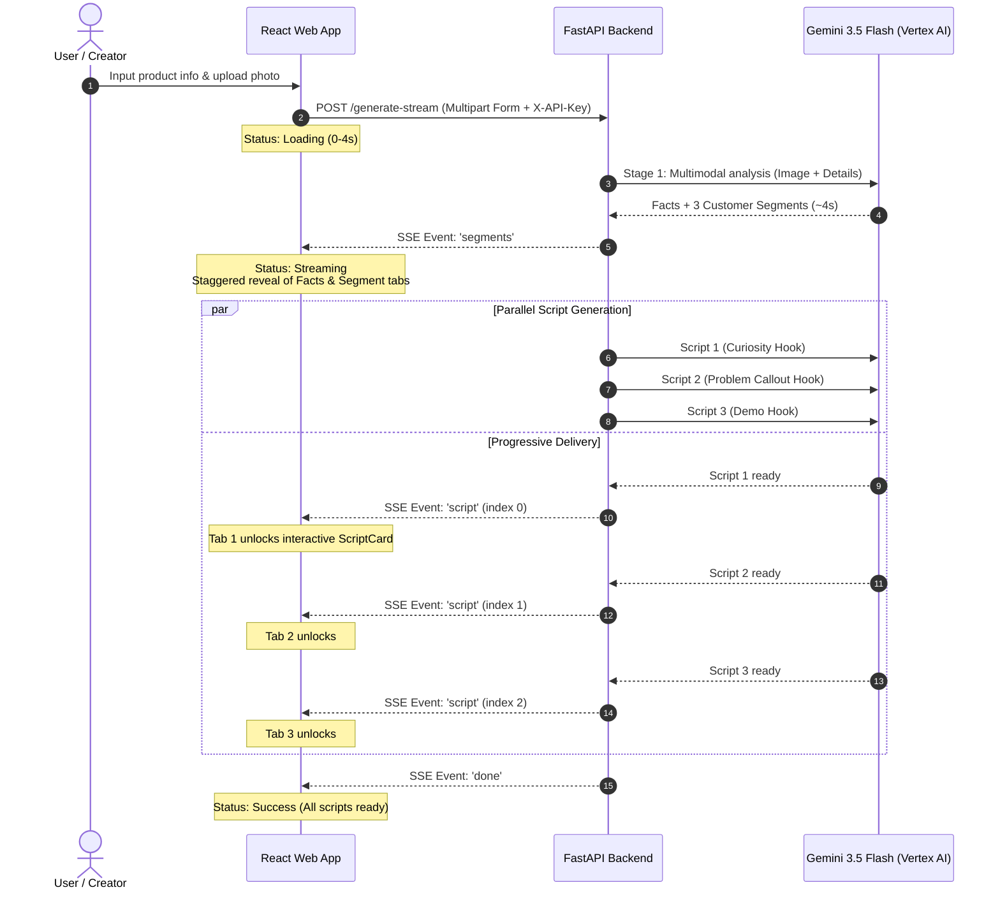

# UG-Scripts (AI UGC Script Writer)

Script Assistant is an AI-powered UGC (User-Generated Content) video ad script generator inspired by platforms like Billo. Given a single product photo and basic product information, it generates three distinct, phone-ready creator scripts tailored to auto-generated customer segments, backed by verifiable packaging facts and psychological reasoning.

---

## The Concept

Direct-to-consumer (DTC) brands and UGC creators spend hours brainstorming hooks, identifying customer pain points, and pacing video ads for TikTok, Instagram Reels, and YouTube Shorts.

Script Assistant automates this creative workflow through a two-stage generative AI pipeline:

1. **Packaging Analysis & Verifiable Claims**: Evaluates the product photo alongside the product description to extract 5–8 verifiable facts (e.g., active ingredients, packaging format, cruelty-free claims). This prevents model hallucinations and ensures creator claims adhere to what the packaging actually states.
2. **Customer Segmentation**: Auto-generates three distinct customer personas tailored to the target market and product category, identifying their core pain points, demographics, and high-performing social platforms.
3. **Paced, Persuasive UGC Scripts**: Concurrently drafts three production-ready video scripts—one per segment—employing dedicated hook styles (Curiosity Question, Problem Callout, Demo / Before-After). Each script includes:
   - Second-by-second pacing calibrated to natural creator speech (~2.5 spoken words per second).
   - A strict 3-second hook window indicator to evaluate scroll-stopping potential.
   - Persuasion technique rationales explaining why specific lines are structured to convert.

---

## Architecture



### Key Technical Pillars
- **FastAPI & Async Streaming**: The backend uses Starlette's `StreamingResponse` over Server-Sent Events (`text/event-stream`). Proxy buffering is disabled via `X-Accel-Buffering: no` and `Cache-Control: no-cache`.
- **Parallel LLM Execution**: Stage 2 executes concurrent script calls via `asyncio.create_task` and yields each script chunk as soon as it resolves using `asyncio.as_completed`.
- **Progressive Frontend Hydration**: The frontend hook reads the SSE `ReadableStream` via `TextDecoder` without external stream parsing libraries, staging UI elements progressively so users never face a blank waiting screen.
- **Contract-Driven Type Safety**: FastAPI exports an OpenAPI 3.1 specification, which is compiled into TypeScript interfaces using `openapi-typescript`, guaranteeing zero drift between frontend contracts and backend schemas.

---

## Setup & Getting Started

### Prerequisites
- **[Bun](https://bun.sh/)** (v1.2+)
- **[Python](https://www.python.org/)** (v3.11+)
- **Google Cloud Project** with the Vertex AI API enabled and billing linked.

---

### 1. Clone the Repository and Install Dependencies

```bash
git clone <repository-url>
cd ug-script-writer
bun install
```

---

### 2. Configure the Python Backend

Create and activate a virtual environment inside the API service, then install requirements:

```bash
cd apps/api
python3 -m venv .venv
source .venv/bin/activate
pip install -r requirements.txt
cd ../..
```

---

### 3. Configure Environment Variables

#### Backend (`apps/api/.env`)
Create `apps/api/.env` with your Google Cloud and API key configuration:

```env
# Google Cloud Vertex AI Configuration
GOOGLE_CLOUD_PROJECT=your-gcp-project-id
GOOGLE_CLOUD_LOCATION=global
GEMINI_MODEL=gemini-3.5-flash

# Shared Secret API Key for client authorization
API_KEY=your-secure-random-api-key

# Optional: CORS allowed origins (comma-separated, defaults to localhost:5173)
ALLOWED_ORIGINS=http://localhost:5173,http://127.0.0.1:5173

# Optional: Local service account key path (if not using gcloud ADC)
# GOOGLE_APPLICATION_CREDENTIALS=/path/to/service-account-key.json
```

Authenticate your local environment with Google Cloud Application Default Credentials (ADC):
```bash
gcloud auth application-default login
gcloud auth application-default set-quota-project your-gcp-project-id
```

#### Frontend (`apps/web/.env.local`)
Create `apps/web/.env.local` to match the backend endpoint and secret:

```env
VITE_API_URL=http://localhost:8000
VITE_API_KEY=your-secure-random-api-key
```

---

### 4. Running the Development Servers

Start both services locally:

**Terminal 1 — Backend (FastAPI)**:
```bash
cd apps/api
.venv/bin/uvicorn main:app --reload --port 8000
```
*API documentation and Swagger UI will be available at [http://localhost:8000/docs](http://localhost:8000/docs).*

**Terminal 2 — Frontend (Vite + React)**:
```bash
bun run dev:web
```
*The web application will open at [http://localhost:5173](http://localhost:5173).*

---

## Useful Commands

| Command | Action |
| :--- | :--- |
| `bun run dev:web` | Starts the Vite React development server |
| `bun run build:web` | Type-checks (`tsc`) and builds the production web bundle |
| `bun run lint:web` | Runs Oxlint linter on the web application |
| `bun run test:api` | Runs Pytest suite (16 tests covering health, auth, validation, and SSE streaming) |
| `bun run gen:types` | Generates TypeScript interfaces from FastAPI OpenAPI schema |
