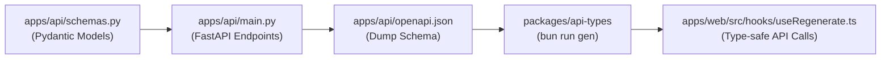

# Sprint 2 API Requirements: Granular Customizability & Regenerations

**Document Version**: 1.0.0  
**Target Release**: Sprint 2  
**Target Services**: `apps/api` (FastAPI), `packages/api-types` (OpenAPI Code-Gen), `apps/web` (`useRegenerate` integration)

---

## 1. Executive Summary & Objective

In Sprint 1, `apps/api` provided monolithic script generation via `POST /generate` and `POST /generate-stream`. These endpoints take a product image and form metadata, run multi-modal extraction (Stage 1), and generate three fixed customer segments and three complete scripts (Stage 2).

Sprint 2 introduces granular, in-place interactivity in the UI:
1. **Fact Editing**: Users can edit, remove, and add product facts without re-uploading the product image.
2. **Segment Regeneration**: Users can replace any single customer segment with an alternative persona without altering the others.
3. **Script Rewriting**: Users can regenerate an entire script for an edited or replaced segment.
4. **Reason Line-Group Rewriting**: Users can regenerate the contiguous group of lines cited by a specific marketing rationale.
5. **Single Line Rephrasing & Regeneration**: Users can rephrase a sentence into distinct tones or replace it with an entirely new line.
6. **Strict Language Retention**: Persistent adherence to the user's selected language (`en` or `bn`) across all initial and regenerative actions.

This specification details the endpoints, Pydantic schemas, prompt engineering contracts, language handling rules, and integration requirements for the backend.

---

## 2. Core Architectural Principles & Language Retention

### 2.1 Principle 1: Images Are Never Re-Sent
In Sprint 2 regenerations, the product image has already been analyzed. All regeneration endpoints operate purely on text:
- Product metadata (`name`, `category`, `market`, `language`).
- Active product facts (`facts: list[str]`).
- Contextual script and segment models.

### 2.2 Principle 2: Strict Language Retention (`en` vs `bn`)
> **Critical Bug Identified**: During testing in the UI, regenerating any segment, reason line-group, or single line reverted the output to English even when the user originally requested Bangla (`bn`).

**Mandatory Backend Requirement**:
- Every regeneration endpoint **must** require `language: Literal["en", "bn"]` as part of its request payload.
- When `language == "bn"`:
  - Dialogue lines (`text`), segment titles (`name`), demographics (`who`), and pain points (`pain_point`) **must** be generated in natural, colloquial spoken Bangla (Bengali script `বাংলা`).
  - The model **must not** emit English or transliterated "Banglish".
  - Performance technique labels and rationale reasons must be delivered in natural Bangla suitable for Bangladeshi digital marketing creators.
  - Tone rephrasing (`casual`, `punchy`, `authentic`, `direct`) must use native Bangla conversational markers and idioms (e.g., `"সত্যি বলতে..."`, `"একটা জরুরি জিনিস জেনে রাখুন:"`, `"কোনো রকম বাড়িয়ে বলছি না—"`).

### 2.3 Principle 3: Targeted, Low-Latency Endpoints
Rather than invoking full multi-stage pipelines for a single line or segment:
- Each granular action has a dedicated, lightweight endpoint.
- Prompts include only necessary contextual lines and facts, keeping token counts low and latency under 1.5 seconds for single lines.
- Responses use Google GenAI structured outputs (`response_schema=...`) via Pydantic models.

---

## 3. Endpoints Specification

### 3.1 Overview Table

| Action | Method & Endpoint | Primary Input Payload | Output Model | Latency Target |
|---|---|---|---|---|
| **Regenerate Single Segment** | `POST /regenerate/segment` | Product meta, facts, current segment, existing segment names | `Segment` | < 2.0s |
| **Rewrite Full Script** | `POST /regenerate/script` | Product meta, facts, target segment, hook style | `Script` | < 3.0s |
| **Rewrite Reason Line Group** | `POST /regenerate/reason-lines` | Product meta, facts, segment, visible script, target line IDs, reason rationale | `ReasonLinesResponse` | < 2.5s |
| **Rephrase Single Line** | `POST /regenerate/line/rephrase` | Product meta, facts, segment, script context, line kind & text, avoid tones | `LineRephraseResponse` | < 1.5s |
| **Regenerate Single Line** | `POST /regenerate/line/regenerate` | Product meta, facts, segment, script context, line kind & text | `LineRegenerateResponse` | < 1.5s |
| **Regenerate Section (Stream)** | `POST /regenerate/section` | Product meta, updated facts, slot configurations | SSE Stream (`segments`, `script`, `done`) | Progressive |

---

### 3.2 `POST /regenerate/segment`

Replaces an existing customer segment with a fresh, distinct demographic persona that differs from all other active segments.

#### Request Schema (`SegmentRegenerateRequest`)
```python
class SegmentRegenerateRequest(BaseModel):
    name: str = Field(..., description="Product name")
    category: str = Field(..., description="Product category")
    market: str = Field(..., description="Target market (e.g., 'Bangladesh', 'Global')")
    language: Literal["en", "bn"] = Field(..., description="Target language ('en' for English, 'bn' for Bangla)")
    facts: list[str] = Field(..., min_length=1, description="Current active product facts")
    current_segment: Segment = Field(..., description="The segment being replaced")
    existing_segment_names: list[str] = Field(
        default_factory=list,
        description="Names of other active segments to guarantee the new one is unique"
    )
```

#### Response Schema
Returns the standard `Segment` model:
```python
class Segment(BaseModel):
    name: str = Field(..., description="Distinct persona title")
    who: str = Field(..., description="Demographics, daily context, and life situation")
    pain_point: str = Field(..., description="Core frustration or desire in their own words")
    platforms: list[str] = Field(..., description="Active short-form video platforms")
```

#### Example (Bangla `language="bn"`)
**Request**:
```json
{
  "name": "Pulse Candy",
  "category": "Confectionery",
  "market": "Bangladesh",
  "language": "bn",
  "facts": [
    "কাঁচা আমের স্বাদযুক্ত শক্ত ক্যান্ডি",
    "ভেতরে টক-ঝাল ট্যাঙ্গি মসলা পাউডার ভরা",
    "প্রতি পিস মাত্র ২ টাকা"
  ],
  "current_segment": {
    "name": "Daily Commuters",
    "who": "Urban commuters",
    "pain_point": "Need a quick refresh",
    "platforms": ["Facebook Watch"]
  },
  "existing_segment_names": ["Campus Students & Teens", "Late Night Study Hustlers"]
}
```

**Response**:
```json
{
  "name": "অফিস ফেরত ক্লান্ত কর্মজীবী",
  "who": "প্রতিদিন বাসে বা জ্যামে দীর্ঘ সময় আটকে থাকা তরুণ ও মধ্যবয়সী চাকুরিজীবী যারা কাজের ফাঁকে বা রাস্তায় ঝিমুনি কাটাতে চান।",
  "pain_point": "বিকেলের দিকে মাথা ধরে যায় আর প্রচণ্ড ক্লান্ত লাগে, এমন কিছু দরকার যা সাথে সাথে মুড চাঙ্গা করে দেয়।",
  "platforms": ["Facebook Watch", "YouTube Shorts"]
}
```

---

### 3.3 `POST /regenerate/script`

Generates a complete, ready-to-film UGC script for a specific customer segment (e.g., after the segment details were updated or replaced).

#### Request Schema (`ScriptRewriteRequest`)
```python
class ScriptRewriteRequest(BaseModel):
    name: str = Field(..., description="Product name")
    category: str = Field(..., description="Product category")
    market: str = Field(..., description="Target market")
    language: Literal["en", "bn"] = Field(..., description="Target language")
    facts: list[str] = Field(..., min_length=1, description="Current product facts")
    segment: Segment = Field(..., description="Target segment (may include user edits)")
    hook_style: str | None = Field(
        None,
        description="Optional hook angle ('curiosity question', 'problem callout', 'demo / before-after')"
    )
```

#### Response Schema
Returns the standard `Script` model:
```python
class Script(BaseModel):
    segment: str
    lines: list[Line]
    reasons: list[Reason]
```

**Validation Constraints**:
- `reasons[i].line_ids` must cite contiguous lines within `1..len(lines)`.
- Exactly 3 reasons must be provided.
- Line 1 must be `kind: "hook"`.
- Last line must be `kind: "cta"`.
- All text strictly in the requested `language`.

---

### 3.4 `POST /regenerate/reason-lines`

Rewrites the contiguous group of lines associated with a specific marketing technique/reason (e.g., when the user clicks the refresh icon on a reason card).

#### Request Schema (`ReasonLinesRewriteRequest`)
```python
class ReasonInfo(BaseModel):
    title: str = Field(..., description="Technique name (e.g., 'Direct Objection Handling')")
    why: str = Field(..., description="Psychological explanation for why this works on the segment")

class ScriptLineContext(BaseModel):
    id: int = Field(..., description="1-based position in visible script")
    kind: Literal["hook", "concept", "cta"]
    text: str = Field(..., description="Dialogue text")

class ReasonLinesRewriteRequest(BaseModel):
    name: str = Field(..., description="Product name")
    market: str = Field(..., description="Target market")
    language: Literal["en", "bn"] = Field(..., description="Target language")
    facts: list[str] = Field(..., description="Current product facts")
    segment: Segment = Field(..., description="Target segment")
    full_script: list[ScriptLineContext] = Field(..., description="Complete sequence of visible script lines")
    target_line_ids: list[int] = Field(..., min_length=1, description="The sequential line IDs to replace")
    reason: ReasonInfo = Field(..., description="The rationale technique to regenerate and strengthen")
```

#### Response Schema (`ReasonLinesRewriteResponse`)
```python
class RewrittenLine(BaseModel):
    kind: Literal["hook", "concept", "cta"] = Field(..., description="Line kind")
    text: str = Field(..., description="New dialogue text in the target language")

class ReasonLinesRewriteResponse(BaseModel):
    lines: list[RewrittenLine] = Field(
        ...,
        min_length=1,
        description="Replacement line sequence (count may vary slightly if required to fulfill the technique)"
    )
```

#### Behavior & Invariants:
1. The model receives `full_script` as narrative context so the replacement lines match the tone, pacing, and vocabulary of surrounding lines.
2. The replacement lines must fit seamlessly between `target_line_ids[0] - 1` and `target_line_ids[-1] + 1`.
3. If the target group includes line 1, the first replacement line must remain `kind: "hook"`.
4. If the target group includes the last line, the final replacement line must remain `kind: "cta"`.

---

### 3.5 `POST /regenerate/line/rephrase`

Rephrases a single script line to maintain the exact core meaning and grammatical subject/object while rewriting it in an alternative tone.

#### Request Schema (`LineRephraseRequest`)
```python
class LineRephraseRequest(BaseModel):
    name: str = Field(..., description="Product name")
    market: str = Field(..., description="Target market")
    language: Literal["en", "bn"] = Field(..., description="Target language")
    facts: list[str] = Field(..., description="Current product facts")
    segment: Segment = Field(..., description="Target customer segment")
    script_context: list[ScriptLineContext] = Field(
        ...,
        description="Visible lines surrounding the target line to maintain narrative flow"
    )
    line_id: int = Field(..., description="Line ID of the target line")
    current_text: str = Field(..., description="Existing line dialogue to rephrase")
    kind: Literal["hook", "concept", "cta"] = Field(..., description="Role of the line")
    avoid_tones: list[str] = Field(
        default_factory=list,
        description="List of tones already attempted for this line (e.g. ['punchy', 'casual'])"
    )
```

#### Response Schema (`LineRephraseResponse`)
```python
class LineRephraseResponse(BaseModel):
    text: str = Field(..., description="Rephrased dialogue text in target language")
    tone: str = Field(..., description="Selected tone identifier (e.g., 'punchy', 'casual', 'authentic', 'direct')")
```

#### Example (Bangla `language="bn"`)
**Request**:
```json
{
  "name": "Pulse Candy",
  "market": "Bangladesh",
  "language": "bn",
  "facts": ["প্রতি পিস মাত্র ২ টাকা"],
  "segment": {
    "name": "কলেজ স্টুডেন্টস",
    "who": "কলেজ পড়ুয়া তরুণ-তরুণী",
    "pain_point": "পকেট মানি কম",
    "platforms": ["TikTok"]
  },
  "script_context": [
    { "id": 1, "kind": "hook", "text": "দামী কোল্ড কফি খাওয়ার কোনো দরকারই নেই!" },
    { "id": 2, "kind": "concept", "text": "পকেট থেকে মাত্র ২ টাকার একটা পালস ক্যান্ডি বের করে মুখে দিন।" }
  ],
  "line_id": 2,
  "current_text": "পকেট থেকে মাত্র ২ টাকার একটা পালস ক্যান্ডি বের করে মুখে দিন।",
  "kind": "concept",
  "avoid_tones": ["casual"]
}
```

**Response**:
```json
{
  "text": "সোজা কথা: পকেটের মাত্র ২ টাকার পালস বের করলেই কিন্তু পুরো মুড ফ্রেশ হয়ে যায়!",
  "tone": "direct"
}
```

---

### 3.6 `POST /regenerate/line/regenerate`

Completely replaces a single line with an alternative angle or idea for that position, fitting into the active script without repeating the old wording.

#### Request Schema (`LineRegenerateRequest`)
```python
class LineRegenerateRequest(BaseModel):
    name: str = Field(..., description="Product name")
    market: str = Field(..., description="Target market")
    language: Literal["en", "bn"] = Field(..., description="Target language")
    facts: list[str] = Field(..., description="Current product facts")
    segment: Segment = Field(..., description="Target customer segment")
    script_context: list[ScriptLineContext] = Field(
        ...,
        description="Visible lines before and after the line"
    )
    line_id: int = Field(..., description="Line ID of the target line")
    current_text: str = Field(..., description="Existing dialogue being replaced")
    kind: Literal["hook", "concept", "cta"] = Field(..., description="Role of the line")
```

#### Response Schema (`LineRegenerateResponse`)
```python
class LineRegenerateResponse(BaseModel):
    text: str = Field(..., description="Freshly generated line in the target language")
    kind: Literal["hook", "concept", "cta"] = Field(..., description="Verified line kind")
```

---

### 3.7 `POST /regenerate/section` (Server-Sent Events)

Re-runs the generation process when product facts are updated in the UI.

#### Key Differences from `POST /generate-stream`:
1. Does **not** re-upload the product image.
2. Accepts `facts: list[str]` directly.
3. Allows preserving hand-edited segments (`keep_segment: bool`). If `keep_segment` is `true`, the backend keeps the segment definition and generates a new script tailored to it with the updated facts. If `false`, it generates a new segment persona.

#### Request Schema (`SectionRegenerateRequest`)
```python
class SlotConfig(BaseModel):
    index: int = Field(..., description="Slot index (0..2)")
    keep_segment: bool = Field(False, description="Whether to keep the existing segment data")
    segment: Segment | None = Field(None, description="Segment to retain if keep_segment is True")

class SectionRegenerateRequest(BaseModel):
    name: str = Field(...)
    category: str = Field(...)
    market: str = Field(...)
    language: Literal["en", "bn"] = Field(...)
    facts: list[str] = Field(..., min_length=1)
    slots: list[SlotConfig] = Field(
        default_factory=list,
        description="Configuration for each slot"
    )
```

#### SSE Stream Events:
- `event: segments` -> Emits the finalized 3 segments (mix of kept and newly generated).
- `event: script` -> Emits each script as it finishes generating for slot index `0..2`.
- `event: done` -> Signals completion.
- `event: error` -> Emits error payload if an unrecoverable failure occurs.

---

## 4. Prompt Engineering & Language Specifications

### 4.1 System Instructions for Language Control

Every regeneration prompt in `apps/api/prompts.py` must embed the following system rule block:

```text
LANGUAGE INSTRUCTION:
You must output all dialogue, personas, pain points, and technique explanations strictly in {language_name} ({language_code}).
- If language is 'Bangla' (bn):
  * Use proper, natural Bengali script (বাংলা).
  * Write in conversational, authentic spoken Bangla used by UGC creators in Bangladesh.
  * DO NOT transliterate English into Bengali script (no "Banglish").
  * DO NOT output English sentences.
- If language is 'English' (en):
  * Use crisp, natural, conversational spoken English.
```

### 4.2 Tone Definition Table (for Rephrasing)

When rephrasing (`/regenerate/line/rephrase`), Gemini must select from one of four verified tones and return the tone tag:

| Tone Tag | English Intent | Bangla Intent (`bn`) | Bangla Style Example |
|---|---|---|---|
| `punchy` | Ultra-concise, fast tempo, high impact | ছোট বাক্য, দ্রুত রিদম, জোরালো শব্দ | "সোজা কথা: ২ টাকায় এমন টেস্ট অসম্ভব।" |
| `casual` | Friendly, relatable, everyday friend advice | আড্ডার ঢং, বন্ধুর মতো পরামর্শ, সহজ ভাষা | "সত্যি বলতে? এটা ট্রাই না করলে মিস করবেন।" |
| `authentic` | Honest, no-hype, genuine user experience | কোনো অতিরঞ্জন নেই, খাঁটি বাস্তব অনুভূতি | "কোনো বাড়াবাড়ি ছাড়াই বলছি, ভেতরে আসলেই আসল মশলা।" |
| `direct` | Clear instruction, focused benefit | সরাসরি বেনিফিট ও সমাধান তুলে ধরা | "কাজের ফাঁকে ঝিমুনি কাটাতে এটাই বেস্ট সমাধান।" |

---

## 5. Implementation Architecture & Code-Gen Pipeline



### 5.1 Steps to Sync API & Frontend Types

1. **Implement Schemas in `apps/api/schemas.py`**:
   Add `SegmentRegenerateRequest`, `ScriptRewriteRequest`, `ReasonLinesRewriteRequest`, `ReasonLinesRewriteResponse`, `LineRephraseRequest`, `LineRephraseResponse`, `LineRegenerateRequest`, `LineRegenerateResponse`, and `SectionRegenerateRequest`.

2. **Mount Routers in `apps/api/main.py`**:
   Implement the endpoints under a clean `/regenerate` router tag.

3. **Export OpenAPI Schema**:
   ```bash
   cd apps/api
   python3 -c "import sys, json; sys.path.insert(0, '.'); from main import app; open('openapi.json', 'w').write(json.dumps(app.openapi(), indent=2))"
   ```

4. **Regenerate TypeScript Types**:
   ```bash
   cd packages/api-types
   bun run gen
   ```

5. **Wire `apps/web/src/hooks/useRegenerate.ts`**:
   Replace simulated timeouts and hardcoded mock variants with real `fetch` calls to the `/regenerate/*` endpoints, passing `workspace.meta.language`.

---

## 6. Implementation Checklist for the API Team

- [ ] **1. Schemas & Models (`apps/api/schemas.py`)**
  - [ ] Add `SegmentRegenerateRequest`
  - [ ] Add `ScriptRewriteRequest`
  - [ ] Add `ReasonLinesRewriteRequest` & `ReasonLinesRewriteResponse`
  - [ ] Add `LineRephraseRequest` & `LineRephraseResponse`
  - [ ] Add `LineRegenerateRequest` & `LineRegenerateResponse`
  - [ ] Add `SectionRegenerateRequest`
  - [ ] Enforce `Literal["en", "bn"]` across all request models.

- [ ] **2. Prompts (`apps/api/prompts.py`)**
  - [ ] Create `REGENERATE_SEGMENT_PROMPT` (guaranteeing uniqueness against `other_segments`).
  - [ ] Create `REWRITE_SCRIPT_PROMPT` (enforcing contiguous reason `line_ids`).
  - [ ] Create `REWRITE_REASON_LINES_PROMPT` (with surrounding script context).
  - [ ] Create `REPHRASE_LINE_PROMPT` (supporting `avoid_tones` and returning `{ text, tone }`).
  - [ ] Create `REGENERATE_LINE_PROMPT` (producing a completely new sentence matching `kind`).
  - [ ] Inject the mandatory Bangla language enforcement block into all prompt templates.

- [ ] **3. Endpoints (`apps/api/main.py`)**
  - [ ] Implement `POST /regenerate/segment`
  - [ ] Implement `POST /regenerate/script`
  - [ ] Implement `POST /regenerate/reason-lines`
  - [ ] Implement `POST /regenerate/line/rephrase`
  - [ ] Implement `POST /regenerate/line/regenerate`
  - [ ] Implement `POST /regenerate/section` (SSE streaming)
  - [ ] Add header authentication check (`check_authorization`) to all new endpoints.

- [ ] **4. Automated Tests (`apps/api/tests/`)**
  - [ ] Test language retention: verify that sending `language="bn"` returns Bengali script in responses.
  - [ ] Test uniqueness: verify that `/regenerate/segment` does not return a name in `existing_segment_names`.
  - [ ] Test line context: verify that `/regenerate/line/*` maintains valid line roles (`hook`, `concept`, `cta`).
  - [ ] Test validation: verify 422 errors when required fields or language codes are invalid.

- [ ] **5. TypeScript Type Export**
  - [ ] Re-dump `apps/api/openapi.json`.
  - [ ] Run `bun run gen` in `packages/api-types`.
  - [ ] Verify `packages/api-types/src/schema.d.ts` contains the new endpoints.
