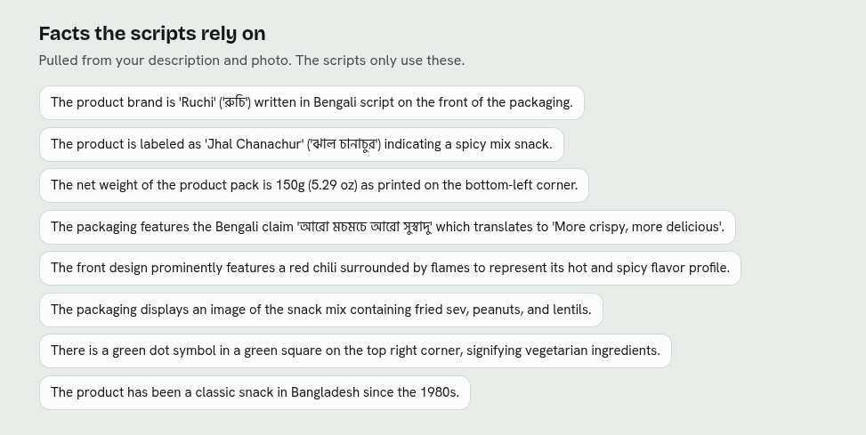
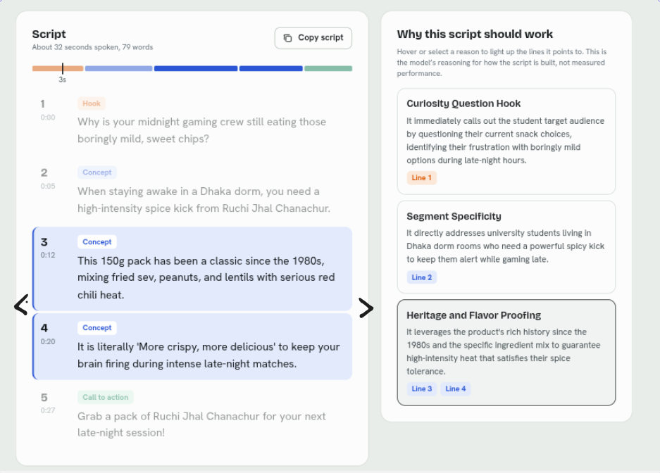
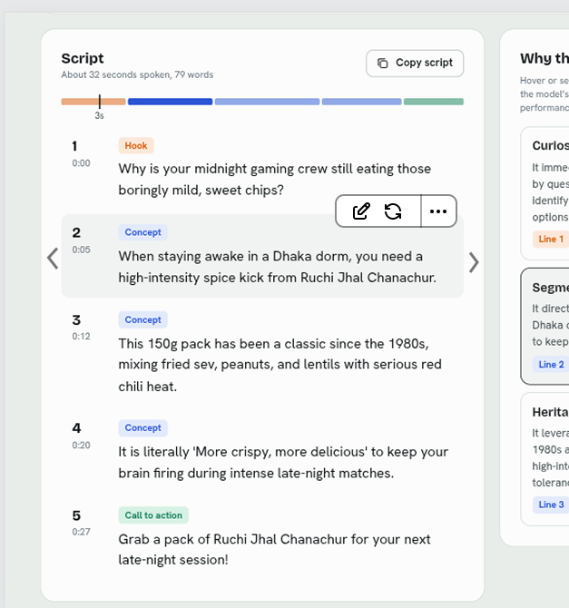

We implemented a working script generator but now we will add more granular customizability and regeneration options to truly refine the script creation process.

Here are the main 4 feature ideas I have for this sprint:

1. The `.chip` elements in the first `.results-section` (the facts section) will be editable. Show a faint edit icon and a cross icon to remove a chip from the `.chip-list`. Editing the facts makes the `.segment-section-animated` section generation stale. You can regenerate the entire section with the updated facts. Figure out an elegant way to visualize this that is non-invasive, meaning you can interact with the components inside even though the section is stale. 

2. The `.tab` buttons in the customer segments tablist (`.tabs[role="tablist"]` inside `.segment-section-animated`) should show a regenerate icon (refresh icon) in the bottom-right corner when hovered. Clicking it will generate a unique customer segment and replace the `.tab` button and its corresponding `.segment-card` with the new one.

3. The `.segment-card` panel (`.panel.segment-card`) will have two buttons at the bottom-right corner of `.segment-main`:
   - A. A save button, which will add this script to "Saved Scripts".
   - B. An edit button that lets you edit the `h3` title, the `.segment-who` paragraph, and the `.tag-list`.
   Updating a customer segment or regenerating the segment will make its script stale. Show a regeneration option while keeping the `.workbench` interactable. A saved script remains in "Saved Scripts" even if the segment is replaced or edited.

4. In the `.workbench` section, we will add much more fine-grained tuning and regeneration of the components:
   - Let's start with the reasons panel (`.panel.reasons`). The `.reason` buttons in `.reason-list` will have a refresh icon at the bottom-right corner. Clicking on it regenerates the associated lines in the `line_ids` of the reason.
   - Each time you regenerate a reason, it will replace the line group that was highlighted. A chevron icon set will appear ("< >") halfway down the total height that will let you switch between versions of that section .
   - Now let's discuss when you select a `li.line` item in the `ol.lines` list:
     - Clicking on a `.line` component deselects the highlighted lines (and reason) and selects a single line.
     - Selecting a single line opens up a context menu with two sections: `(edit, rephrase, regenerate) | (dots)`.
     - Clicking on the dots opens up an additional menu where you can undo/redo and delete the line.
     - I understand there can be some clashes since you can move between versions of a "reason line group" and single lines themselves. Just know that a single line has its own "history" and can revert back to its previous states individually. Not sure what happens if reason regenerations add/remove lines. Figure out an elegant solution for this.
     - The context menu button `rephrase` maintains the subject and object of the sentence while rewriting it in a different tone.
     - The regenerate button (reload icon) replaces the entire sentence and generates a unique sentence that fits into the current script.
     - The edit button lets you edit the text and type into place.
     - Include small labels next to the context menu icons.

As you can see, this is a pretty extensive feature update that requires significant architectural reconsiderations in both `api` and `web` app.

UI-Bugs:
- The screen doesn't move down enough as the customer segments are generated, forcing users to scroll down. Move the screen down enough to show the customer segments that were added (`.segment-section-animated`) along with the generating script card box (`.script-skeleton-card` / `.script-card`) in full view of window.

Future Feature (out of scope for this sprint):
- Token counting mechanism to calculate cost per generation and script.