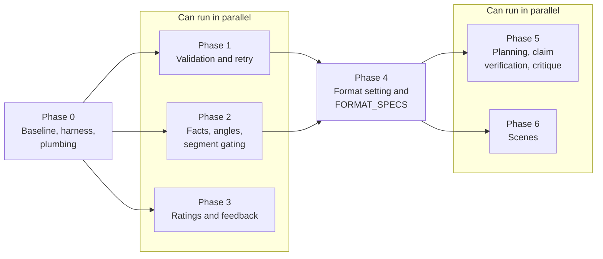
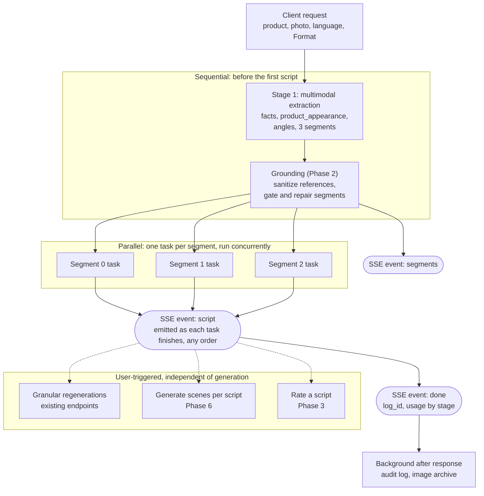
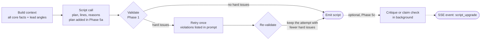

# Sprint 4 Plans: Script Quality Pipeline

> **Location**: `docs/sprints/4. Pipeline optimization /sprint4-plans.md`
> **Audience**: the local coding agent (and engineers) who will plan and implement Sprint 4
> **Read first**: `project-context.md` (architecture), `ideas.context.md` (code-level context), `ideas.md` (product ideas and decisions)
> **Last updated**: 2026-11-11
> **Authoring note**: this plan was written from the three documents above, not from the code. Items marked **VERIFY** are assumptions the implementer must check against the repository before building on them.

---

## 1. Objective and Success Criteria

Raise the quality of generated scripts, for both UGC and 30s commercial formats, in English and Bangla, without losing the zero-hallucination guarantee on product claims.

Quality problems being fixed:

| Problem | Root cause | Addressed by |
| :--- | :--- | :--- |
| Scripts quote label and color trivia | Prompt says "use only the facts", so facts double as creative material | Phase 2 (facts vs. angles) |
| Scripts sound like ads, not creators | No voice spec, no examples, no banned phrases | Phase 4 (`FORMAT_SPECS`) |
| Length, hook-timing and structure rules ignored | Rules exist only in prompt text | Phase 1 (validation and retry) |
| Repetitive token stuttering / degeneration loops (e.g. "কককক") | Model sampling collapse when expressing technical/foreign specs under strict "no transliteration" rules | Phase 1 (repetition loop detector & low-temp retry), Phase 4 (Bengali-script loanword code-mixing) |
| Feature-dump lines | Every script sees the same flat fact list | Phase 2 (per-segment context), Phase 5 (planning) |
| Segments with no product support | No gating after Stage 1 | Phase 2 (segment gating) |
| No way to tell whether a change helped | No eval set, no baseline | Phase 0 (harness), Phase 3 (ratings) |

**Success criteria** (measured with the Phase 0 harness against the Phase 0 baseline):

1. Validator pass rate on first attempt is reported, and after retry it is at least 95% on the eval matrix.
2. Banned-phrase hit rate drops by at least 80% against baseline.
3. Blind human review prefers the new pipeline over baseline on a majority of eval items (UGC voice, specificity, persona fit).
4. Time to first script event (TTFC) stays within about 1.5 seconds of baseline.
5. Zero scripts in the eval set make a product claim that is unsupported by the facts (see Phase 5c).

Targets 1 and 2 are starting points; adjust after seeing baseline numbers.

---

## 2. Decisions Already Made

From the product owner, not up for re-debate:

- The selector is called **Format** (values: UGC, 30s Ad). It applies **per generation run**, not per product. The same product can be regenerated in the other format.
- Facts are a hard tier (the only things a script may *claim*). Angles are a soft tier (framing, scenes, feelings, objections, demos; never a guaranteed claim).
- Scenes are generated in their own stage, triggered by a button. Scenes may span several lines, and a single line may span several scenes. Scenes are saved with the script. Scene prompts stay **model-neutral** for now.
- Angle controls ("must use" / "avoid") are deferred until angles have been generated and reviewed.
- Project invariants from `project-context.md` still hold: spoken dialogue in the selected language, while personas, facts and reasons stay English (**VERIFY**, see 3.1), no medical claims, no superlatives, no invented numbers or testimonials.

Decided here as defaults (change if the owner disagrees):

| Question | Default |
| :--- | :--- |
| Emit policy for deterministic validation | Gated: validate before emit, retry only on failure |
| Emit policy for LLM critique | Not shipped until the eval harness shows it is worth it; if shipped, optimistic (`script_upgrade` event) |
| Rating signal | Thumbs up/down plus optional tags, plus implicit signals (copy, save, regenerate) |

---

## 3. Corrections and Additions to `ideas.context.md`

`ideas.context.md` is a good map of the code. These items in it should **not** be implemented as written.

### 3.1 Issues to correct

| # | Item in `ideas.context.md` | Problem | Resolution |
| :-- | :--- | :--- | :--- |
| 1 | Hook limit in `validate_script` | Comment says "~7-9 words", code checks `> 10`, message says "8 words or fewer" | One `hook_max_words` value in the format spec (see 9.1); message generated from the same value |
| 2 | Word ranges 60-90 / 65-80 hard-coded in the validator | Belongs with the format, not in validator logic | Store `word_range` in each format spec (see 9.1); the validator reads it. Seconds and speech-rate estimates stay decorative and are not validated |
| 3 | Retry returns second output unvalidated | A bad second attempt ships silently | Validate again; keep the attempt with fewer issues; log `quality_flags`; never fail the request over soft rules |
| 4 | Segment gating checks `not segment.target_angle_indices` | Model can reference any angle, so this catches almost nothing | Require at least one angle that is fact-grounded; repair by regenerating only the bad segment (reuse `/regenerate/segment` logic), not rerunning Stage 1 |
| 5 | Stage 2 passes only facts grounded by the segment's angles | Can drop core claims the script needs | Always include all `core` facts; add other facts only if a lead angle references them |
| 6 | 1-based list indices for `based_on` and `target_angle_indices` | LLMs make off-by-one errors; edits shift positions | Stable integer `id` on every `Fact` and `Angle`; references use ids; invalid references are dropped by a sanitizer, not crashed on |
| 7 | `Fact.value` descriptions ("active ingredients", "packaging text") | Written for cosmetics; apparel, electronics etc. break the categories | Category-agnostic definitions (see Phase 2) |
| 8 | `LANGUAGE_BLOCK` unchanged next to a UGC code-mixing rule | Block says "no Banglish" and "no English phrases", contradicting `FORMAT_SPECS` | Language block becomes a function of (language, format) |
| 9 | Language block scope | The prompt in the owner's message says to output **everything** (personas, reasons) in the selected language; `project-context.md` says personas, facts and reasons always stay English | **VERIFY** which is live in `prompts.py`; this plan assumes `project-context.md` (English for non-dialogue) |
| 10 | `format` as a request field name | Shadows the Python builtin | Use `script_format` |
| 11 | `format` added only to `ScriptRewriteRequest` and `SectionRegenerateRequest` | Line rephrase, line regenerate and reason-lines also write dialogue and must obey voice rules | Add `script_format` and `language` to all of them |
| 12 | Feedback written with `set(..., merge=True)` on `generation_logs/{log_id}` | Audit doc is written by a background task after the response; a merge-write to a missing doc is later overwritten by the audit `set`. Also any authenticated user can write to any `log_id` | Separate feedback storage (see Phase 3) |
| 13 | Scene `ai_visual_prompt` described as "ready for Midjourney/Runway" | Contradicts the model-neutral decision | Field renamed `generation_prompt` and composed by code from structured fields (11.1); no model names in prompts |
| 14 | Scene schema | No duration, no product appearance, nothing to keep scenes aligned with lines that overlap | See Phase 6 |
| 15 | Critique threshold "score < 7.5" | Arbitrary; LLM self-scores are poorly calibrated | Do not ship until measured offline (Phase 5c) |
| 16 | Context caching via `system_instruction` | Prompts are a few hundred tokens; cache minimum-size thresholds likely not met | Moving static text into `system_instruction` is still worthwhile for structure; treat caching as low priority and **VERIFY** thresholds before investing |
| 17 | Temperature 0.2 / 0.7 split | Treated as settled | Treat as a hypothesis. **VERIFY** the recommended temperature for the configured Gemini model in Vertex AI docs, then test in the harness |
| 18 | `ScriptScenes.look_bible` as a single object | A scene can have several characters with different wardrobes; one object cannot represent that | Characters become a list referenced by id; shared visual style is its own object (11.1) |

### 3.2 Missing from `ideas.context.md`

- **Eval harness and baseline** (Phase 0). Nothing else can be judged without it.
- **Planning fields inside the script schema** (Phase 5a), the zero-extra-latency version of the "angle brief".
- **Per-stage token telemetry**, needed to cost the new stages (angles, retries, critique, scenes).
- **Prompt and pipeline versioning** in audit logs.
- **Claim verification** as the first critique target (Phase 5c).
- **`product_appearance`** extracted once in Stage 1 so scenes can restate the product's look without re-sending the photo (Phase 2, used in Phase 6).

---

## 4. Phase Overview and Dependencies

| Phase | Name | Depends on | Touches API contract | Touches frontend |
| :-- | :--- | :--- | :---: | :---: |
| 0 | Baseline, harness, plumbing | none | additive only | no |
| 1 | Validation and retry | 0 | no | no |
| 2 | Facts, angles, segment gating | 0 | **yes (breaking, with compat shim)** | yes |
| 3 | Ratings and feedback | 0 | additive | yes |
| 4 | Format setting and `FORMAT_SPECS` | 1, 2 | yes | yes |
| 5 | Planning fields, claim verification, critique | 0, 1, 4 | internal | maybe |
| 6 | Scenes | 2, 4 | yes (new endpoints) | yes |

Phases 2 and 3 are independent and can run in parallel after Phase 0. Phases 5 and 6 are independent once Phase 4 lands. After every schema change run `bun run gen:types` and commit `packages/api-types` with the change.

### 4.1 Implementation phases and parallel lanes



### 4.2 Target runtime pipeline

Where the phases land in a generation request. Phase numbers show which phase introduces each step. Stage 1 is the only sequential bottleneck, so its latency governs time to first script. The three segment tasks run concurrently, and a retry delays only its own script. Scenes, ratings and granular regenerations are user-triggered and independent of generation.



### 4.3 Inside one segment task

Each of the three parallel tasks above runs this flow independently.



**Every phase ships behind the existing tests plus new ones, and ends with a harness run compared to baseline.**

---

## 5. Phase 0: Baseline, Harness, Plumbing

**Goal:** make improvement measurable and instrument the pipeline. No user-visible behavior change.

### 5.1 `ask_gemini` plumbing (`apps/api/main.py`)

Extend the signature, keeping current callers working:

```python
async def ask_gemini(
    prompt: str,
    schema: type[Any],
    parts: Sequence[Any] = (),
    max_retries: int = 1,
    *,
    temperature: float | None = None,
    system_instruction: str | None = None,
    stage: str = "unspecified",   # "extract" | "script" | "rephrase" | "critique" | "scenes" ...
) -> Any: ...
```

- Pass `temperature` and `system_instruction` into `types.GenerateContentConfig` only when not `None`.
- `max_retries` remains the **transport/parse** retry. Validation retries (Phase 1) are a separate layer and must not reuse it.
- `record_gemini_usage` receives `stage`; the `TokenAccumulator` in `apps/api/usage.py` keeps a per-stage breakdown. `done.usage` keeps its current top-level fields and gains `by_stage: {stage: {input_tokens, output_tokens, total_tokens}}`. The `X-Token-Usage` header is unchanged.

### 5.2 Versioning

- Add `PIPELINE_VERSION = "s4.0"` and a small `PROMPT_VERSIONS: dict[str, str]` (one label per template) in `prompts.py`. Bump on every prompt change.
- Write both, plus `model`, `script_format` (once it exists) and `language`, into every `generation_logs` document via `audit.py`.

### 5.3 Eval harness (new `apps/api/evals/`)

```
apps/api/evals/
  products/            # ~10 JSON fixtures + images, across categories
  run.py               # python -m apps.api.evals.run --label baseline --format ugc --language en
  metrics.py           # deterministic metrics
  rubric.md            # human scoring template, per format
  results/<label>/     # JSONL outputs, gitignored except baselines
```

- **Fixtures:** about 10 products spanning apparel, hair/skincare, electronics, food, home goods, with Bangladesh-market descriptions. Include a couple of weak-description products and one product likely to tempt medical claims.
- **Runner:** calls the pipeline functions directly (not over HTTP), for the full matrix: products x formats x languages. Before Phase 4 only `ugc` exists. **VERIFY** the pipeline can be invoked without FastAPI request context; if not, extract plain async functions (`run_stage1`, `run_stage2`) from `main.py` first. That extraction is allowed and expected here, with no behavior change.
- **Deterministic metrics** (`metrics.py`): validator violation rates per rule, word-count distribution, hook word count, banned-phrase hits, Bengali-script ratio, line-kind sequence correctness, per-stage latency and tokens.
- **Human rubric** (`rubric.md`): 1-5 on hook strength, specificity, persona fit, fact compliance, creator voice (UGC) or brand polish (ad), filmability. Prefer blind pairwise comparisons (A vs. B) when evaluating a change.
- **LLM judge:** optional. Only trust it after calibrating against at least 20 human-scored items; keep it out of success criteria until then.
- **Baseline:** run the full matrix on the *unchanged* pipeline and commit the metrics summary. Everything after is compared to this.

**Acceptance:** `run.py` produces a baseline report; a pytest-level smoke test runs the harness with a mocked `ask_gemini`; existing 34 tests still pass.

---

## 6. Phase 1: Deterministic Validation and Retry

**Goal:** enforce the rules the prompts already state.

### 6.1 Validator (`apps/api/validation.py`, new)

Pure functions, no I/O, fully unit-testable. Takes a `Script`, a format spec, and a language. Until Phase 4 introduces `FORMAT_SPECS`, a module-level `UGC_DEFAULTS` (`word_range=(60, 90)`, `hook_max_words=10`) stands in for the spec. Returns structured issues rather than raising:

```python
@dataclass
class Issue:
    code: str          # e.g. "word_count_high"
    severity: Literal["hard", "soft"]
    message: str       # shown to the model on retry
```

| Check | Severity |
| :--- | :--- |
| Exactly 3 reasons; each cites at least one line | hard |
| Reason `line_ids` exist, are unique, and are contiguous | hard |
| Line ids are 1..N sequential | hard |
| First line is `hook`; no `hook` after the opening; last line is `cta` | hard |
| Dialogue is in the requested script (Bengali character ratio over non-space, non-punctuation characters, threshold tuned from the harness, starting near 0.65) | hard |
| Repetitive character or token loops: any sequence of $\ge 4$ identical consecutive characters (e.g. `কককক`, `aaaa`), repeated n-grams ($3+$ duplicate 3-grams), or degenerate lexical diversity ($\text{unique words} / \text{total words} < 0.45$) | hard |
| Total words outside the format's `word_range` by more than a tolerance (start at 10%) | hard |
| Words inside range but near the edge | soft |
| Hook words above the format's `hook_max_words` (formats that define one) | soft within +20%, hard beyond |
| Banned-phrase hit (per-language lists, case-insensitive; Bangla list needs native-speaker input) | hard |

Notes:

- Count words consistently for Bangla (whitespace split is acceptable to start; punctuation-stripped).
- Word ranges and the hook limit come from the format spec, not from validator logic. Seconds and speech-rate estimates are decorative and are not validated.
- Language check must not fail legitimate content: platform names and digits are excluded from the ratio. When Phase 4 allows code-mixing for UGC, English loanwords written in **Bengali script** still count as Bengali; only Latin-script text lowers the ratio.
- **Repetitive Stuttering / Degeneration Detection**: In low-resource multilingual tokenizers (especially Bengali), models can fall into mode collapse loops where a single consonant or syllable repeats (e.g. `অকক কককককককক...`, seen in `pepsodent-sensitive-expert`). The validator must:
  1. Detect consecutive character repetition using regex `r'(.)\1{3,}'` (4 or more identical characters in a row).
  2. Detect repeated 3-gram phrases appearing 3+ times in a single script.
  3. Measure lexical diversity ($\text{unique words} / \text{total words} < 0.45$).
  Any hit is classified as **hard**. The retry prompt explicitly tells the model: *"The previous output degenerated into a repetitive character/word loop ('{repetition_sample}'). Write natural, varied dialogue with complete sentences and no character repetition."* The retry call should run with a reduced temperature (e.g. `0.2`) to escape the sampling trap.

### 6.2 Generic validated-call helper

Avoid copy-pasting retry loops across endpoints:

```python
async def ask_validated(
    *, prompt, schema, parts=(), stage, temperature,
    validate: Callable[[Any], list[Issue]],
    build_correction: Callable[[str, Any, list[Issue]], str],
    max_validation_retries: int = 1,
) -> tuple[Any, list[Issue]]: ...
```

Behavior:

1. Call `ask_gemini`; run `validate`.
2. If there are no hard issues, return.
3. Otherwise build a correction prompt: original prompt, the **previous output**, and the numbered violations with concrete numbers ("87 words, expected 60-80"). Retry once, at a lower temperature if the harness shows that helps.
4. Validate again. Return the attempt with the fewest hard issues, plus its remaining issues. Never raise for validation failures.

### 6.3 Integration points

- `generate_single_script` (Stage 2): gated. A script that needs a retry delays only that script; `asyncio.as_completed` ordering already tolerates this.
- `/regenerate/script` and the script phase of `/regenerate/section`: same helper.
- `/regenerate/reason-lines`: validate kind boundaries (first line stays `hook`, last stays `cta`) and contiguity.
- Remaining issues after retry are written to the audit log as `quality_flags`. They are not shown to users in this phase.

**Acceptance:** unit tests for every check with passing and failing fixtures (English and Bangla); a mocked-Gemini test of the retry path (fails once then passes; fails twice and returns the better attempt); harness shows first-attempt violation rate (new baseline of "how often the model breaks rules") and post-retry rate; TTFC change reported.

**Risk:** retries add latency to tail scripts. Use the Phase 0 first-attempt failure rate to estimate the cost; if above roughly 30%, fix the prompt before relying on retries.

---

## 7. Phase 2: Facts, Angles, Segment Gating

**Goal:** give scripts creative material that is not label trivia, while keeping claims grounded.

### 7.1 Schemas (`apps/api/schemas.py`)

```python
class Fact(BaseModel):
    id: int
    text: str
    value: Literal["core", "visual", "trivia"]
    # core:   what the product is or does, or a guarantee the seller makes (material, function, benefit-bearing spec)
    # visual: something visible on or about the product (color, pattern, shape, packaging look)
    # trivia: minor detail that rarely persuades (small labels, fittings, minor design details)

AngleType = Literal[
    # --- Claim-bearing: asserts something about the product, so it must cite at least one fact ---
    "benefit",           # An outcome the buyer gets, inferred from a fact.
                         #   e.g. breathable fabric -> "no stuck-to-your-back feeling on a crowded commute"
    "demo",              # Something that can be shown on camera to prove a fact.
                         #   e.g. pinch the fabric, hold it to the light, wear it in front of a fan
    "objection",         # A hesitation the buyer has, plus the fact-backed answer to it.
                         #   e.g. "linen wrinkles" -> the relaxed fit makes a lived-in look the point
    # --- Framing: sets up the situation or feeling; never asserts product capabilities; facts optional ---
    "use_moment",        # A specific situation in which the product gets used.
                         #   e.g. the 8am commute, a Friday office day, a wedding in July
    "identity",          # How the buyer wants to feel or be seen.
                         #   e.g. looking effortless while everyone else looks wilted
    "contrast",          # The buyer's current alternative or status quo, without naming competitors.
                         #   e.g. shirts that cling and need an undershirt
    "audience_context",  # Market or cultural reality shaping the buyer's day; unrelated to the product itself.
                         #   e.g. humid summers, festival season, no AC in transit
]

CLAIM_BEARING = {"benefit", "demo", "objection"}   # based_on must be non-empty for these

class Angle(BaseModel):
    id: int
    type: AngleType               # copy the definitions above into this Field's description so the model sees them
    text: str
    based_on: list[int] = []      # Fact ids. Required when type is in CLAIM_BEARING; optional otherwise
    source: Literal["model", "user"] = "model"   # "user" = added by hand in the UI; framing types only

class Segment(BaseModel):
    name: str; who: str; pain_point: str; platforms: list[str]
    lead_angle_ids: list[int] = []

class Segments(BaseModel):
    product_facts: list[Fact]
    product_appearance: str       # 2-3 sentences: what the product looks like (shape, colors, materials, packaging), from the photo
    angles: list[Angle]           # about 8-12
    segments: list[Segment]       # exactly 3
```

**Why these seven types.** The first draft had six (`benefit`, `moment`, `objection`, `demo`, `emotion`, `context`). They overlapped (`emotion` vs. `benefit`, `moment` vs. `context`), and the grounding rule ("empty only for `context`") was an awkward special case. This set is split by the rule that matters downstream: claim-bearing types must cite facts, framing types may not assert product capabilities. Changes:

- `emotion` became `identity` (clearer, and no longer overlaps `benefit`).
- `moment` became `use_moment` and `context` became `audience_context`, so the two are not confused.
- `contrast` is new: comparing against the buyer's current alternative is a common UGC technique that is distinct from objection handling.

Considered and rejected: social proof (forbidden, since testimonials are not allowed), urgency or offer (not derivable from product data), pain point (already on the segment), and price or value (if the description states a price, it becomes a `benefit` citing that fact).

Keep this a `Literal` rather than free-form tags, because the gating logic (7.3) depends on it. Expect to revise the set after reviewing the first batch of generated angles.

Compatibility: the current contract is `product_facts: list[str]`. Add a `mode="before"` validator that coerces bare strings into `Fact(value="core", id=<position>)` on request models, so older clients and any stored data keep working. **VERIFY** where facts appear: Stage 1 output, `SegmentRegenerateRequest`, `ScriptRewriteRequest`, `SectionRegenerateRequest`, line-level requests, the frontend fact chips, and wherever saved scripts persist (see 7.5).

### 7.2 Stage 1 prompt (`SEGMENT_PROMPT`)

- Facts stay verifiable and drawn only from the description and photo. Add the `value` tag. Seller-provided description claims outrank photo-derived ones.
- Angles use the types defined in 7.1. Claim-bearing types (`benefit`, `demo`, `objection`) cite at least one fact id; framing types never assert product capabilities. Ask for a spread of types rather than eight benefits.
- Segments must differ in motivation, each with `lead_angle_ids` (2-3 angles).
- `product_appearance`: factual description of the product as pictured.
- Keep temperature low for facts. If a single call cannot hold both low-temperature extraction and creative angles, keep one call and measure first; do not split without data.
- Language rule: all of this output is English.

Watch Stage 1 latency (currently about 3.5s). Angles add output tokens. Record the delta; if TTFC regresses by more than the success criterion allows, shorten angle count or text length before considering a split.

### 7.3 Post-processing and gating (new `apps/api/grounding.py`)

Deterministic, no LLM:

1. **Sanitize references:** drop `based_on` ids that do not exist; drop claim-bearing angles left with no valid grounding; drop invalid `lead_angle_ids`.
2. **Gate segments:** each segment needs at least one lead angle of a claim-bearing type (after step 1 these are necessarily fact-grounded). If not, regenerate that one segment through the existing `/regenerate/segment` code path (negative divergence from the other two segments included), once. If it still fails, assign the two best claim-bearing angles (priority `benefit`, `demo`, `objection`) and log a flag.
3. **Build per-segment script context:** all `core` facts, plus any `visual` or `trivia` fact referenced by a lead angle, plus the lead angles, plus the full `product_appearance` only for scenes (not for scripts).

### 7.4 Stage 2 prompt (`SCRIPT_PROMPT`)

Replace "Use only the facts above" with the two-tier rule:

> Every claim about the product must trace to a listed fact. Situations, scenes, feelings, objections and demonstrations come from the listed angles and your own creativity. Do not state an angle as a product guarantee. Trivia facts may appear only as passing visual detail, never as the point of a line.

Keep the existing prohibitions (no medical claims, no "#1", no invented numbers or testimonials).

### 7.5 Regeneration endpoints and frontend

- `/regenerate/segment` returns a segment with `lead_angle_ids`.
- Fact edits: deleting a fact removes angles whose only grounding was that fact (framing-type angles are kept); editing fact text keeps dependent angles. No automatic angle re-derivation in this phase. **Decision for owner if undesired.**
- `/regenerate/section` (after fact updates) must pass the full fact and angle sets through and preserve hand-edited segments as today.
- Frontend: angle chips beside fact chips (editable, deletable, addable; user-added angles get `source="user"` and are framing-only), a visible `value` indicator on facts (low-key, e.g. a dimmed style for trivia), segment cards show which angles they lead with. **VERIFY** whether saved scripts are stored client-side or in Firestore; whatever holds them must accept the new shapes without migration errors.

**Acceptance:** unit tests for sanitizer, gating (mocked `ask_gemini`), legacy-string coercion, context builder (core facts always present); harness comparison versus baseline on trivia-line rate (manual review) and persona fit; `bun run gen:types` clean.

---

## 8. Phase 3: Ratings and Feedback

**Goal:** turn demo-access usage into a dataset.

### 8.1 Backend

- Generate `log_id` **before** the pipeline starts and pass it to the audit background task, so the `done` event can include it. **VERIFY** how `audit.py` currently creates `log_id`.
- `done` event payload gains `log_id`. Regular REST endpoints can return it in a response header.
- New collection `script_feedback`, document id `{log_id}_{script_index}`, upserted idempotently. Fields:

```python
class ScriptFeedbackRequest(BaseModel):
    log_id: str
    script_index: int
    rating: Literal[-1, 1]                      # thumbs down / up
    tags: list[str] = []                        # constrained set below
    comment: str | None = Field(None, max_length=500)
    script_snapshot: Script                     # exactly what the user saw when rating, edits included
    script_format: str; language: str
    segment_name: str
```

The server adds `access_code` from the auth context, `pipeline_version`, `prompt_versions` (sent by client or looked up from the log if it exists), and `created_at`. No dependency on the audit document existing, so there is no write race, and ownership is implicit because the stored `access_code` is the caller's.

- Constrained tags (shown after thumbs-down; optional after thumbs-up): `bland`, `sounds_like_an_ad`, `wrong_tone`, `too_long`, `weak_hook`, `unrealistic`, `wrong_language`, `great_hook`. These map directly onto rubric criteria.
- Rate limit the endpoint with the existing limiter pattern.
- Implicit signals: copy, save and "regenerate this script" counts, recorded as increments on the same feedback document (or a sibling `events` map). Regenerating a script shortly after receiving it is a negative signal worth keeping.

### 8.2 Frontend

Thumbs control on each script, tag chips after thumbs-down, no required input. Do not block the UI on the request.

**Acceptance:** endpoint tests with a fake Firestore client; idempotency (rating twice updates, not duplicates); feedback readable by a small export script `apps/api/scripts/export_feedback.py` that writes JSONL for use as eval and few-shot candidates.

---

## 9. Phase 4: Format Setting and `FORMAT_SPECS`

**Goal:** one pipeline, two formats, driven by data.

### 9.1 `FORMAT_SPECS` (`apps/api/prompts.py`)

Each spec is a dict (or dataclass) with:

| Field | Purpose |
| :--- | :--- |
| `id`, `label` | `"ugc"`, `"commercial_30s"` |
| `ad_context` | Replaces "short-form UGC video ads (TikTok, Reels, Shorts)" in `SEGMENT_PROMPT` |
| `word_range` (min, max) | Total spoken words the validator accepts; start UGC at 60-90 and ads at 65-80, then tune from harness data |
| `voice` | Voice rules (first-person creator vs. polished brand, VO allowed) |
| `structure` | Beat guidance mapped onto the existing `hook` / `concept` / `cta` kinds |
| `hook_styles` | Ordered list of three; replaces the hard-coded hook list indexed by script position |
| `hook_max_words` | Soft limit on hook length (start at 10) for UGC; `None` for ads |
| `banned_phrases` | `{"en": [...], "bn": [...]}` |
| `language_style` | `{"en": ..., "bn": ...}`, including code-mixing permission |
| `few_shot` | Examples per language, keyed by hook style |
| `use_speaker_visual` | Whether lines carry `speaker` and `visual` |

Initial hook styles: UGC keeps Curiosity Question, Problem Callout, Demo / Before-After. Ads: Cold-Open Scene, Slice of Life Problem, Product-as-Hero Reveal.

Timing language (for example "about 30 seconds") may appear in prompt text as guidance for the model, but nothing in code validates seconds. Prompts describe beats without second-level micro-timing unless the harness shows it helps.

### 9.2 Prompt assembly

- `build_language_block(language, format)` replaces the static `LANGUAGE_BLOCK`. For UGC Bangla, permit common English loanwords **written in Bengali script** and forbid Latin-script English sentences. For ads, stricter standard Bangla. Persona, facts, angles and reasons stay English (3.1 item 9).
  * *Root cause of Bengali degeneration loops:* The previous static rule `DO NOT transliterate English into Bengali script (no Banglish)` created high perplexity when the model encountered technical, scientific, or brand terms (e.g. "Hydroxyapatite", "remineralization", "dentine tubules" in Pepsodent). The model could not translate the scientific term, was forbidden from writing Latin English script, and was forbidden from transliterating, triggering sampling collapse into repeated character loops (`কককক`). Explicitly permitting Bengali-script phonetic transliteration of technical and brand terms (e.g. 'হাইড্রোক্সিপ্যাটাইট', 'এনামেল', 'সেনসিটিভিটি') directly eliminates this prompt-induced perplexity dead-end.
- `build_format_block(format, language, hook_style)` injects voice, structure, length, banned phrases, and the **single** few-shot example matching the assigned hook style (not all examples, to limit copying).
- Examples are product-category-neutral or from categories absent from the eval fixtures, to avoid leakage into eval scores. **Bangla examples must be written or reviewed by a native speaker** (owner action).
- Move static role and rule text into `system_instruction` while touching these prompts.

### 9.3 Schema and endpoints

```python
class Line(BaseModel):
    id: int
    kind: Literal["hook", "concept", "cta"]
    text: str
    speaker: str | None = None   # ads: "Voiceover", "On camera", "On-screen text"
    visual: str | None = None    # short shot cue, <= about 12 words
```

- Add `script_format: Literal["ugc", "commercial_30s"] = "ugc"` to `/generate`, `/generate-stream`, and every regeneration payload (3.1 item 11). Default keeps old clients working.
- The detailed visual direction belongs to Scenes (Phase 6). `Line.visual` stays a terse cue so the two do not diverge. For UGC, the prompt tells the model to leave `speaker` and `visual` empty.
- Validators (Phase 1) read the spec: ranges, hook rule, banned lists. For ads add a soft check that every line has a `speaker`.
- Stage 1 uses `ad_context`, which also steers `platforms` in segments.

### 9.4 Frontend

Format toggle in the product form (alongside Script language), sent with each generation. Render `speaker` and `visual` only when present. Regenerating with a different format on the same product re-runs Stage 2 only (facts, angles and segments stay), with Stage 1 re-run available explicitly. **VERIFY** current "regenerate" UX supports this without re-uploading the image.

**Acceptance:** unit tests for prompt assembly (snapshot tests per format x language), validator per format, endpoint default behavior; harness full matrix (format x language) with the per-format rubric; confirmation that UGC output no longer trips the banned list and ads do not trip UGC rules.

---

## 10. Phase 5: Planning, Claim Verification, Critique

**Goal:** lift quality beyond what rules can enforce. Each step is gated on harness evidence.

### 10.1 Phase 5a: planning fields in the script call (no extra latency)

Introduce an LLM-facing schema distinct from the API `Script`:

```python
class ScriptPlan(BaseModel):
    core_promise: str
    lead_angle_ids: list[int]
    proof_moment: str            # the visible demonstration or evidence beat
    objection: str | None
    techniques: list[str]        # three, in English

class ScriptDraft(BaseModel):
    plan: ScriptPlan             # first, so the model commits before writing
    lines: list[Line]
    reasons: list[Reason]        # must correspond to the plan's techniques
```

The API returns `Script` (without `plan`; log `plan` in the audit document). Compare against the no-plan variant in the harness. Field order in the schema matters: `plan` first.

### 10.2 Phase 5b: separate angle-brief call

Only if 5a shows no measurable gain: one cheap call per segment before Stage 2 returning the same `ScriptPlan`. Costs sequential latency; accept only with clear harness gains.

### 10.3 Phase 5c: claim verification, then critique

First measure baseline hallucination rate offline: a verifier prompt extracts every product claim in a script and marks each supported or unsupported by the fact list. Run it in the harness only. If unsupported claims are rare, stop here and skip shipping a verifier.

If they are common, ship verification as a gated check (it protects the core guarantee, so latency is acceptable for flagged scripts). A subjective critique-and-rewrite pass (hook strength, specificity, voice) runs offline first and ships only if it shows a human-confirmed lift. If shipped:

- Emit the first draft immediately; run critique in the background; on rewrite emit `{"event": "script_upgrade", "index": i, "script": ...}`.
- The frontend replaces by index **only if the user has not edited or regenerated anything in that script**; otherwise the upgrade is discarded. Show a subtle indicator when a script was upgraded.

---

## 11. Phase 6: Scenes

**Goal:** a user-triggered stage producing visual, action-based directions per script, usable as prompts for AI image or video tools later.

### 11.1 Schemas (model-neutral)

A scene can have several on-screen characters with different wardrobes, so characters are a **list** that scenes reference by id. Shared visual style is a separate single object. There is no combined "bible" object.

```python
class Character(BaseModel):
    id: str                   # "c1", "c2": stable reference used by scenes
    label: str                # short handle used in directions, e.g. "the commuter", "the colleague"
    description: str          # age range, build, hair, distinguishing features; enough to keep a generated person consistent
    wardrobe: str             # default outfit; for a character using the product this includes how the product looks on them

class VisualStyle(BaseModel):
    palette: str              # dominant colors
    lighting: str             # overall lighting character, e.g. "harsh midday sun"
    mood: str                 # emotional register of the visuals
    camera_feel: str          # e.g. "handheld phone footage" vs. "smooth cinematic movement"

class SceneCharacter(BaseModel):
    character_id: str
    appearance_note: str | None = None   # only when this scene differs from the default, e.g. "same outfit, visibly sweat-soaked"

class Scene(BaseModel):
    scene_number: int
    line_ids: list[int]       # lines covered; overlap between scenes is allowed
    duration_seconds: float   # approximate clip length for downstream video tools; not validated
    setting: str              # place, time of day, environment
    characters: list[SceneCharacter]     # who is on screen; may be empty for product-only shots
    action: str               # verb-driven physical beat: what the camera sees, including what each character does
    props: str                # objects in frame, including exactly how the product appears
    camera: str               # framing and movement
    on_screen_text: str | None = None    # overlay text, in the script language
    generation_prompt: str = ""          # composed by code, never written by the LLM (see below)

class ScenesDraft(BaseModel):            # LLM-facing output schema
    visual_style: VisualStyle
    characters: list[Character]
    scenes: list[Scene]

class ScriptScenes(ScenesDraft):         # API and persisted shape
    product_appearance: str              # copied from Stage 1; never written by the scenes call
```

**`generation_prompt` is composed by code.** A pure function `compose_generation_prompt(scene, characters, visual_style, product_appearance)` builds a self-contained, model-neutral English prompt from the setting, the full description and wardrobe of each character in the scene (applying any `appearance_note`), the action, props, camera, the style fields, and `product_appearance`. Benefits:

- Consistency is guaranteed by construction instead of depending on the LLM to copy the same text into every prompt.
- Prompts can never contain relative references such as "same as before".
- Editing a character's wardrobe can refresh every scene prompt without another LLM call.

`on_screen_text` is not included in the composed prompt, because image and video generators render text poorly; it is overlaid afterwards. **Decide when building the UI** where the composer runs after a user edits a character: a cheap non-LLM endpoint (`POST /scenes/compose`, recommended) or a TypeScript port in `packages/`.

`Script` gains `scenes: ScriptScenes | None = None` so scenes persist with the script. **VERIFY** the saved-scripts mechanism (client storage vs. Firestore) and store scenes wherever scripts are stored.

### 11.2 Endpoints

- `POST /scenes/generate`: input is the script lines, segment, facts, angles, `product_appearance`, product name and category, market, `script_format`, `language`. The LLM returns a `ScenesDraft`; the server adds `product_appearance`, composes each `generation_prompt`, and returns a `ScriptScenes`. One call per script, no streaming needed. Never triggered automatically by the generation pipeline.
- `POST /scenes/regenerate`: regenerate one scene by `scene_number`, given the neighbouring scenes and the existing `characters` and `visual_style`, which stay unchanged.
- `POST /scenes/compose` (non-LLM): recompose `generation_prompt` for all scenes after the user edits a character or the visual style.
- Rate limiting: reuse the pattern; consider a separate bucket since these calls are heavier.

### 11.3 Prompting rules

- Scene content (characters, style, directions) and the composed `generation_prompt` are written in **English** because image and video generators perform best that way; only `on_screen_text` follows the script language. Confirm with the owner.
- Visuals only: describe what the camera sees; no abstract directions ("convey comfort").
- Every person who appears must be defined in `characters` and referenced by id. Scenes never describe a person's looks inline, so the composer can inject the single canonical description. Prefer 1-3 characters; UGC usually needs one.
- Do not depict product features absent from facts or `product_appearance`.
- Scene counts by format (UGC about 3-5, ads about 4-6) via `FORMAT_SPECS`. `duration_seconds` is an approximate clip length and is not validated against speech rate.
- UGC is phone-shot, handheld, real locations; ads may be cinematic. Delivered through `FORMAT_SPECS` fields (`scene_style`, `scene_count`).
- Local context: settings, people and objects appropriate to the target market, not generic stock imagery.

### 11.4 Validation

Run through `ask_validated`: every script line id appears in at least one scene; `line_ids` valid; scene numbers sequential; every `character_id` references a defined character and every defined character appears in at least one scene; `duration_seconds` positive; scene text fields free of relative references to other scenes (regex for "same as", "previous scene", "again", "as before"). Retry once with specifics. `generation_prompt` is produced afterwards by the composer, so it needs no LLM validation.

### 11.5 Frontend

"Generate scenes" button per script; scene cards with copy buttons for the direction and for `generation_prompt`; per-scene regenerate; an editable characters panel (description and wardrobe) and a visual-style panel. Mark scenes **stale** on the client whenever a script line is edited or regenerated after scenes exist (simple flag, persisted with the script), with a regenerate prompt.

**Acceptance:** unit tests for the validator, the prompt composer (golden outputs) and the stale-flag logic; mocked-Gemini endpoint tests; manual review of 10 scene sets from the eval products for filmability, product accuracy and cross-scene consistency; per-stage token cost for `scenes` reported.

---

## 12. Testing Strategy

- Keep the suite offline. All new tests mock `ask_gemini` and Firestore.
- Pure-function modules (`validation.py`, `grounding.py`, and the scene prompt composer) get exhaustive unit tests, including Bangla fixtures.
- Prompt assembly gets snapshot tests per format x language so accidental edits are visible in review.
- Contract tests: legacy string facts, default `script_format`, `done` event shape (existing fields intact, `log_id` and `by_stage` additive).
- The harness is run manually (needs Vertex credentials) and is never part of CI. Commit only summary reports.
- After every schema change: `bun run gen:types`, confirm `packages/api-types` compiles with `apps/web`.

---

## 13. Open Items

Owner decisions or inputs needed:

1. Native-speaker review and authoring of Bangla few-shot examples and the Bangla banned-phrase list (before Phase 4 ships).
2. Confirm the default rating UI (thumbs plus tags) and implicit signals (Phase 3).
3. Confirm the angle lifecycle on fact edits (7.5) and that scene content stays English (11.3).
4. Whether to ship `script_upgrade` at all (decided by Phase 5c data).
5. Review the angle type set (7.1) after the first batch of generated angles.

Facts the implementer must verify in the repository:

1. Which language block is live regarding persona and reason language (3.1 item 9).
2. Where facts and scripts are persisted on the client side, and whether saved scripts live in Firestore.
3. Whether the pipeline can be called outside FastAPI (5.3).
4. How `log_id` is created in `audit.py` (Phase 3).
5. Recommended temperature for the configured Gemini model, and context-caching minimums (3.1 items 16 and 17).