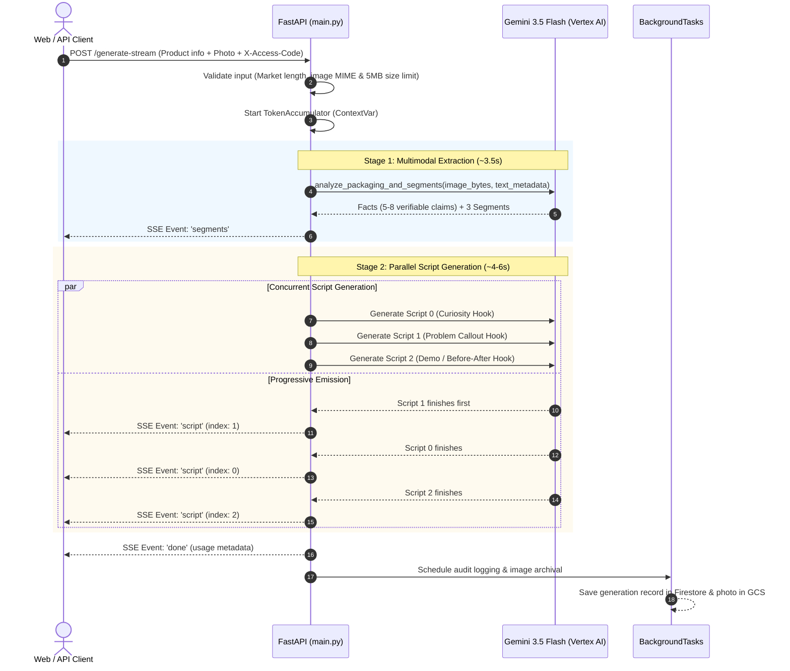

# Project Context & Backend Reference Manual: Generation, Regeneration & SSE Pipeline

> **Document Location**: `docs/sprints/4. Pipeline optimization /project-context.md`  
> **Target Audience**: Backend Engineers, Systems Architects, and AI Agents entering Sprint 4  
> **Scope**: Generation Pipeline, Regeneration Engines, SSE Architecture, Prompt Engineering & Cloud Infrastructure  
> **Last Updated**: 2026-11-11 (Post-Sprint 3 Live Deployment)

---

## 1. System Overview & Philosophy

**UG-Scripts** is an automated User-Generated Content (UGC) video ad script generation and refinement engine designed for performance marketing teams and direct-to-consumer (D2C) brands. Given a product photo and marketing metadata, the platform generates high-converting, phone-ready creator video scripts (20–35s duration) structured for TikTok, Instagram Reels, and YouTube Shorts.

### Core Architectural Pillars
1. **Zero-Hallucination Fact Grounding**: The system performs multimodal extraction directly from product packaging and descriptions (Stage 1). Generated scripts can **only** cite verified product packaging facts. Medical claims, superlatives (e.g., "#1"), and unverified claims are strictly forbidden.
2. **Parallelized Multi-Model Execution**: Once customer personas are established, script generation for all three target segments runs concurrently using asynchronous tasks (`asyncio.create_task` and `asyncio.as_completed`).
3. **Progressive SSE Streaming**: Clients receive incremental generation results via Server-Sent Events (`text/event-stream`), drastically reducing time-to-first-content (TTFC) from ~15s to ~3–4s.
4. **Surgical Granular Regeneration**: Users can regenerate or rephrase any individual line, rewrite contiguous line blocks governed by psychological marketing techniques, or replace audience personas without rerunning the full pipeline.
5. **Strict Language Partitioning**: Spoken dialogue lines are generated in the selected language (`en` or natural spoken Bengali script `বাংলা`). Crucially, audience personas, product facts, and marketing rationales **always remain in English** to maintain marketing precision.
6. **Keyless Cloud Security**: Production deployments on Google Cloud Run use Application Default Credentials (ADC) and the Google Cloud Metadata Server for keyless, zero-secret authentication to Vertex AI Gemini, Firestore Native, and Cloud Storage.

---

## 2. Backend Architecture & Infrastructure

```
┌─────────────────────────────────────────────────────────────────────────────┐
│                             Client Application                              │
└─────────────────────────────────────────────────────────────────────────────┘
                                  │   ▲
          HTTP POST (Multipart / JSON)│   │ SSE Stream (text/event-stream)
                                  ▼   │
┌─────────────────────────────────────────────────────────────────────────────┐
│                          FastAPI Backend Service                            │
│  apps/api/main.py  •  apps/api/auth.py  •  apps/api/usage.py                │
├─────────────────────────────────────────────────────────────────────────────┤
│  Middleware & Security:                                                     │
│  - X-Access-Code verification with 60s in-memory TTL caching               │
│  - Sliding-window rate limiting (15 req/min on granular regenerations)      │
│  - Request-scoped TokenAccumulator via ContextVar                           │
└─────────────────────────────────────────────────────────────────────────────┘
          │                           │                           │
          ▼ ADC                       ▼ ADC                       ▼ ADC
┌──────────────────┐        ┌──────────────────┐        ┌──────────────────┐
│ Vertex AI Gemini │        │ Firestore Native │        │  Cloud Storage   │
│ gemini-3.5-flash │        │ (ugstar default) │        │ (ugstar-audit)   │
├──────────────────┤        ├──────────────────┤        ├──────────────────┤
│ - Multimodal Pt1 │        │ - access_codes   │        │ - Archived user  │
│ - 3x Parallel Pt2│        │ - access_requests│        │   product photos │
│ - Regenerations  │        │ - generation_logs│        │                  │
└──────────────────┘        └──────────────────┘        └──────────────────┘
```

### Core Technologies
- **Runtime**: Python 3.12+ running on `uvicorn` inside Debian Linux (`python:3.12-slim`).
- **Framework**: FastAPI with Pydantic v2 data validation and schema generation.
- **LLM Engine**: `google-genai` SDK on Google Cloud Vertex AI (Default model: `gemini-3.5-flash`, Location: `global`).
- **Database**: Google Cloud Firestore (Native Mode) for access gating, leads, and audit logging.
- **Object Storage**: Google Cloud Storage (`google-cloud-storage`) for image archiving.
- **Containerization**: Multi-stage `Dockerfile` with automated root `.env` loading and static SPA serving.

---

## 3. The Core Generation Pipeline (Stages 1 & 2)



### Stage 1: Multimodal Packaging Extraction
- **Function**: `analyze_packaging_and_segments()` in `apps/api/main.py`.
- **Inputs**: Product Name, Category, Description, Target Market, and Image bytes (JPEG, PNG, WebP up to 5 MB) or preset Demo Product ID.
- **Vertex AI Call**: Multimodal prompt including `types.Part.from_bytes(data=image_bytes, mime_type=content_type)`.
- **Structured Schema**: `Segments` model in `apps/api/schemas.py`.
- **Outputs**:
  - `product_facts`: Exactly 5–8 bulleted, verifiable facts extracted exclusively from visible packaging text, active ingredients, spec sheets, color cues, and user description.
  - `segments`: Exactly 3 target audience personas. Each persona must diverge in core motivation and daily context, containing `name`, `who` (demographics and life situation), `pain_point` (first-person frustration in their own words), and `platforms` (e.g., TikTok, Instagram Reels).

### Stage 2: Parallel Script Generation
- **Function**: `generate_single_script(index, segment)` in `apps/api/main.py`.
- **Concurrency**: 3 independent coroutines dispatched simultaneously via `asyncio.create_task()`.
- **Hook Styles**: System automatically distributes 3 distinct hook methodologies:
  1. Index 0: `Curiosity Question` (provocative question challenging an assumption).
  2. Index 1: `Problem Callout` (identifies immediate frustration within the first 3 seconds).
  3. Index 2: `Demo / Before-After` (immediate visual/action transformation hook).
- **Output Schema**: `Script` model in `apps/api/schemas.py`:
  - `lines`: Ordered list of `Line` items (`id`, `kind`, `text`). Line kinds are strictly tagged as `hook` (first 3 seconds), `concept` (body delivery and proof), or `cta` (conversion action).
  - `reasons`: Exactly 3 `Reason` items (`title`, `why`, `line_ids`). Each rationale explains why a specific marketing technique converts that persona and cites contiguous line IDs.

---

## 4. The SSE Streaming Pipeline

Streaming is handled by FastAPI's `StreamingResponse` using the standard `text/event-stream` media type. Proxy buffering is disabled via explicit response headers:
```python
headers = {
    "Cache-Control": "no-cache",
    "Connection": "keep-alive",
    "X-Accel-Buffering": "no",
}
```

### SSE Wire Protocol & Event Sequence
All messages follow the standard SSE line formatting: `data: <JSON_STRING>\n\n`.

#### 1. Stage 1 Completion (`event: segments`)
Emitted immediately when packaging analysis finishes (~3.5 seconds into the request):
```json
{
  "event": "segments",
  "facts": [
    "Cold-pressed red onion extract with 5% kalonji oil",
    "Glass dropper bottle with dosage markers (30ml)",
    "Fragrance-free, sulfate-free, and cruelty-free formulation"
  ],
  "segments": [
    {
      "name": "Postpartum Hair Loss Seekers",
      "who": "New mothers aged 26-34 noticing hairline thinning 3-6 months postpartum",
      "pain_point": "I feel like clumps come out every time I shampoo, and regular oils just make my scalp sticky.",
      "platforms": ["TikTok", "Instagram Reels"]
    },
    {
      "name": "Office Desk Stress Sufferers",
      "who": "Corporate professionals aged 24-38 facing stress-induced diffuse shedding",
      "pain_point": "Dhaka traffic and work stress are wrecking my hair, but I don't have time for complicated salon treatments.",
      "platforms": ["Instagram Reels", "YouTube Shorts"]
    },
    {
      "name": "Clean Beauty Enthusiasts",
      "who": "Conscious shoppers aged 20-30 avoiding artificial perfumes and mineral oils",
      "pain_point": "Commercial hair oils smell overpowering and leave yellow residue on my pillow.",
      "platforms": ["TikTok"]
    }
  ]
}
```

#### 2. Stage 2 Progressive Scripts (`event: script`)
Emitted as soon as any of the three parallel Gemini calls completes (typically between 5.5s and 8.0s):
```json
{
  "event": "script",
  "index": 0,
  "script": {
    "segment": "Postpartum Hair Loss Seekers",
    "lines": [
      {
        "id": 1,
        "kind": "hook",
        "text": "বাচ্চা হওয়ার পর চুল পড়ে মাথার তালু দেখা যাচ্ছে?"
      },
      {
        "id": 2,
        "kind": "concept",
        "text": "শ্যাম্পু করার সময় এক গাদা চুল হাতে উঠে আসলে ভয় পাওয়াটাই স্বাভাবিক।"
      },
      {
        "id": 3,
        "kind": "concept",
        "text": "এই কোল্ড-প্রেসড অনিয়ন আর কালোজিরা তেলে কোনো কেমিক্যাল বা কৃত্রিম সুগন্ধি নেই।"
      },
      {
        "id": 4,
        "kind": "concept",
        "text": "ড্রপার দিয়ে রাতে স্ক্যাল্পে কয়েক ফোঁটা লাগিয়ে ম্যাসাজ করলেই যথেষ্ট।"
      },
      {
        "id": 5,
        "kind": "cta",
        "text": "আজই ট্রাই করুন আর চুল পড়ার ঝামেলা থেকে মুক্তি পান।"
      }
    ],
    "reasons": [
      {
        "title": "Immediate Problem Identification",
        "why": "Hooks the new mother by addressing the emotional shock of postpartum hair fall in the first sentence.",
        "line_ids": [1]
      },
      {
        "title": "Empathy and Agitation",
        "why": "Normalizes her anxiety while describing the visceral daily reality of shower shedding.",
        "line_ids": [2]
      },
      {
        "title": "Clean Ingredient Reassurance",
        "why": "Directly resolves safety concerns for nursing mothers by highlighting the chemical-free and fragrance-free formulation.",
        "line_ids": [3, 4]
      }
    ]
  }
}
```

#### 3. Pipeline Termination (`event: done`)
Emitted when all tasks have finished and token telemetry is reconciled:
```json
{
  "event": "done",
  "usage": {
    "input_tokens": 1420,
    "output_tokens": 892,
    "total_tokens": 2312
  }
}
```

#### 4. Error Handling (`event: error`)
If an exception occurs mid-stream, remaining background tasks are cancelled via `task.cancel()` and an error payload is yielded:
```json
{
  "event": "error",
  "detail": "Vertex AI rate limit exceeded. Please retry in a few seconds."
}
```

---

## 5. Granular Regeneration Architecture

Sprint 2 introduced six dedicated granular regeneration endpoints in `apps/api/main.py`. Each endpoint operates under a sliding-window rate limit (15 req/min) enforced by `check_regeneration_rate_limit`.

| Endpoint | Method | Payload Model | Response Model | Description |
| :--- | :---: | :--- | :--- | :--- |
| `/regenerate/segment` | `POST` | `SegmentRegenerateRequest` | `Segment` | Generates a single new customer persona strictly divergent from all existing active personas. |
| `/regenerate/script` | `POST` | `ScriptRewriteRequest` | `Script` | Completely rewrites a full script for an edited or regenerated segment against updated facts. |
| `/regenerate/reason-lines` | `POST` | `ReasonLinesRewriteRequest` | `ReasonLinesRewriteResponse` | Rewrites only the contiguous lines cited by a marketing rationale while maintaining surrounding context. |
| `/regenerate/line/rephrase` | `POST` | `LineRephraseRequest` | `LineRephraseResponse` | Rephrases an individual line into one of 4 specific tones (`punchy`, `casual`, `authentic`, `direct`). |
| `/regenerate/line/regenerate`| `POST` | `LineRegenerateRequest` | `LineRegenerateResponse` | Replaces an individual line with a completely new creative angle matching its structural role. |
| `/regenerate/section` | `POST` | `SectionRegenerateRequest` | SSE Stream (`event-stream`) | Progressively regenerates segments and scripts after fact updates, preserving hand-edited segments. |

### Granular Regeneration Mechanics

#### 1. Negative Persona Divergence (`/regenerate/segment`)
When regenerating a segment, the prompt receives the name and description of the persona being replaced, plus the names of the other two active segments. It enforces negative constraints:
```python
other_names = "\n".join(f'- Other active segment: "{name}"' for name in payload.existing_segment_names)
# Injected into REGENERATE_SEGMENT_PROMPT:
# "This segment must be COMPLETELY DIFFERENT from all of the following existing segments..."
```

#### 2. Surgical Reason Group Rewriting (`/regenerate/reason-lines`)
When a creator clicks the regenerate icon on a rationale card (e.g., "Clean Ingredient Reassurance" covering lines 3–4):
- The prompt is provided with the **full current script** for contextual awareness.
- It is instructed to output replacement lines specifically for positions 3–4 that strengthen that technique.
- Boundary conditions are enforced: If position 1 is replaced, line 1 must remain kind `hook`. If the final position is replaced, it must remain kind `cta`.

#### 3. Four-Tone Line Rephrasing (`/regenerate/line/rephrase`)
Allows creators to alter dialogue delivery without changing message substance:
- `punchy`: Ultra-concise, fast tempo, high impact.
- `casual`: Friendly, relatable peer advice.
- `authentic`: Honest, understated, no-hype user experience.
- `direct`: Clear instruction, focused benefit, no fluff.
- `avoid_tones`: Passes previously attempted tones to ensure the model chooses a distinct alternative on sequential clicks.

---

## 6. Prompt Engineering & Prompt Templates

All prompt templates are maintained in [`apps/api/prompts.py`](file:///home/bast0k/projects/ug-script-writer/apps/api/prompts.py).

### The Universal Language Enforcement Block
Injected into every script generation and regeneration prompt:
```text
LANGUAGE INSTRUCTION:
- ONLY the spoken video script dialogue lines (hook, concept, cta) must be written in {language_name} ({language_code}).
- Customer segments (name, who, pain_point, platforms), product facts, and marketing rationale (reasons: title, why) MUST ALWAYS be written in English.
- If language is 'Bangla' (bn):
  * Spoken video script dialogue lines (hook, concept, cta) must be written in proper, natural Bengali script (বাংলা).
  * Write dialogue in conversational, authentic spoken Bangla used by UGC creators in Bangladesh.
  * DO NOT transliterate English into Bengali script (no "Banglish").
  * DO NOT output English sentences for spoken dialogue lines.
  * Customer segments, marketing reasons, and platform names MUST remain strictly in English.
- If language is 'English' (en):
  * Use crisp, natural, conversational spoken English for script dialogue lines.
```

### Stage 1: Extraction Prompt (`SEGMENT_PROMPT`)
```text
You are a performance-marketing strategist for short-form UGC video ads
(TikTok, Reels, Shorts) in {market}.

PRODUCT
Name: {name}
Category: {category}
Description: {description}
The attached image is the product photo. Read it closely: packaging
text, ingredients/specs, colors, size cues, anything a viewer notices.

LANGUAGE REQUIREMENT:
- All product facts and customer segments MUST ALWAYS be written in English.

TASK
1. product_facts: 5-8 concrete, verifiable facts drawn ONLY from the
   description and image in English. No invented claims.
2. segments: exactly 3 customer segments most likely to buy in English. They must
   differ in motivation, not just age. For each: name, who (age range,
   situation, daily context), pain_point (in their own words in English), platforms.
Be specific. 'Young professionals' is too vague.
```

### Stage 2: Script Generation Prompt (`SCRIPT_PROMPT`)
```text
You write scripts that a creator films on a phone for a short-form ad in
{market}. Write in {language}, spoken and natural, never ad-copy stiff.

PRODUCT: {name} ({category})
FACTS YOU MAY USE:
{facts}
TARGET: {segment_name}: {who}. Pain point: {pain_point}
HOOK STYLE: {hook}

RULES
- 20-35 seconds spoken (about 60-90 words).
- Structure: hook (first 3 seconds, must stop the scroll), concept, cta.
  Tag each line with its kind and number lines from 1.
- Use only the facts above. No medical claims, no '#1', no made-up
  numbers or testimonials.
- Speak to this segment's pain point, not to everyone.
- reasons: exactly 3. Each names a specific technique in English (pattern
  interrupt, specificity, objection handling, social proof, etc.),
  explains in English why it works for THIS segment, and lists the line_ids that
  use it. The title and why fields of each reason MUST ALWAYS be in English. Never cite a line that does not do what you claim.
```

### Single-Line Rephrase Prompt (`REPHRASE_LINE_PROMPT`)
```text
You are rewriting a single line from a short-form UGC video script.
The creator films on their phone in {market}.

{language_block}

PRODUCT: {name}
FACTS YOU MAY USE:
{facts}
TARGET: {segment_name}: {who}. Pain point: {pain_point}

SURROUNDING SCRIPT (for context):
{script_context}

LINE TO REPHRASE (line {line_id}, kind: {kind}):
"{current_text}"

TASK
Rephrase this line using a DIFFERENT TONE while keeping the exact same
core meaning — same subject, same object, same core claim. The sentence
structure and wording must clearly change; do not just swap one word.

AVAILABLE TONES (pick one):
- punchy: Ultra-concise, fast tempo, high impact. Short sentences.
- casual: Friendly, relatable, everyday friend giving advice.
- authentic: Honest, no-hype, genuine user experience. Understated.
- direct: Clear instruction, focused benefit, no fluff.

{avoid_tones}

RULES
- Output exactly ONE rephrased line.
- The rephrased text must be in {language_name}.
- The kind stays "{kind}" — do not change the line's structural role.
- Use only the product facts listed above.
- Return the rephrased text and the tone tag you chose.
```

---

## 7. Security, Telemetry & Background Operations

### Access Control (`apps/api/auth.py`)
- **5-Character Codes**: Access codes in Firestore collection `access_codes` are standardized to 5 alphanumeric characters (e.g., `DEMO1`, `DHAKA`, `BETA1`, `UG001`).
- **In-Memory TTL Caching**: Verified codes are cached in memory for 60 seconds (`CACHE_TTL_SECONDS = 60.0`) to prevent redundant Firestore reads during high-frequency line regenerations.
- **Offline / Local Container Fallback**: `FALLBACK_ACCESS_CODES` in `auth.py` ensures the local Docker container functions offline without active GCP credentials.
- **Admin Bypass**: Passing a valid `X-API-Key` grants administrative bypass for integration tests and developer workflows.
- **Lead Capture (`/auth/request-access`)**: Rate-limited endpoint (max 5 requests / 10 minutes) writing user leads to Firestore collection `access_requests`.

### Token Telemetry (`apps/api/usage.py`)
- **Request-Scoped Accumulator**: Uses Python's `contextvars.ContextVar` (`TokenAccumulator`) to cleanly track tokens across asynchronous concurrent tasks without race conditions.
- **Automatic Interception**: `ask_gemini()` automatically extracts `response.usage_metadata` (`prompt_token_count`, `candidates_token_count`, `total_token_count`) and aggregates them into the active accumulator.
- **Telemetry Egress**:
  - Regular REST endpoints emit usage in the `X-Token-Usage` response header.
  - SSE streaming endpoints emit usage in the `event: done` message payload.

### Asynchronous Audit Logging (`apps/api/audit.py`)
- **Non-Blocking Background Tasks**: Uses Starlette's `BackgroundTasks`. Tasks are awaited on the main `asyncio` event loop **after** HTTP response bytes are flushed to the client.
- **Firestore Logging**: Writes complete audit documents to `generation_logs`, recording `access_code`, `endpoint`, `timestamp`, `product_meta`, `request_payload`, `response_payload`, and `usage`.
- **GCS Image Archival**: User-uploaded product photos are archived into Google Cloud Storage bucket `ugstar-audit-images` under `uploads/{year}/{month}/{day}/{uuid}.{ext}`.

---

## 8. Data Models & Schemas Reference

All models are defined in [`apps/api/schemas.py`](file:///home/bast0k/projects/ug-script-writer/apps/api/schemas.py).

```python
class Line(BaseModel):
    id: int                                # 1-based sequential index
    kind: Literal['hook', 'concept', 'cta'] # Script beat role
    text: str                              # Spoken dialogue

class Reason(BaseModel):
    title: str                             # Marketing technique name (e.g., 'Curiosity Gap Hook')
    why: str                               # Explanation why it converts this segment
    line_ids: list[int]                    # Contiguous line IDs demonstrating the technique

class Script(BaseModel):
    segment: str                           # Segment persona name
    lines: list[Line]                      # Ordered script lines
    reasons: list[Reason]                  # Exactly 3 technique rationales

class Segment(BaseModel):
    name: str                              # Vivid persona title
    who: str                               # Demographics and daily life context
    pain_point: str                        # First-person frustration quote
    platforms: list[str]                   # Social video channels (TikTok, Reels, etc.)

class Segments(BaseModel):
    product_facts: list[str]               # 5-8 verifiable packaging claims
    segments: list[Segment]                # Exactly 3 customer personas
```

---

## 9. Backend Directory & File Index

| File Path | Component Role |
| :--- | :--- |
| `apps/api/main.py` | FastAPI application initialization, route endpoints, Gemini integration (`ask_gemini`), SSE event generators, static SPA serving. |
| `apps/api/prompts.py` | Prompt templates for Stage 1, Stage 2, and all granular regeneration actions, plus language enforcement blocks. |
| `apps/api/schemas.py` | Pydantic v2 schemas defining Vertex AI structured output contracts and API response models. |
| `apps/api/auth.py` | Access code authentication, in-memory TTL caching, fallback codes, and lead capture handling. |
| `apps/api/usage.py` | Request-scoped `ContextVar` token meter accumulator and usage tracking utilities. |
| `apps/api/audit.py` | Background audit logging to Firestore collection `generation_logs` and photo archival to Google Cloud Storage. |
| `apps/api/firebase.py` | ADC-authenticated singleton clients for Firestore Native and Cloud Storage. |
| `apps/api/demo_products.py` | 12-item demo product shelf catalog with offline fallback presets. |
| `apps/api/rate_limiter.py` | In-memory sliding-window rate limiters for anti-spam protection. |
| `apps/api/scripts/seed_firestore.py` | CLI administrative script to seed initial access codes and demo catalog products into Firestore. |
| `apps/api/requirements.txt` | Python package dependencies (`fastapi`, `uvicorn`, `google-genai`, `google-cloud-firestore`, `google-cloud-storage`, `pydantic`). |
| `apps/api/tests/` | Pytest test suite containing 34 offline unit and integration tests (`test_auth.py`, `test_telemetry.py`, `test_validation.py`, `test_regenerate.py`). |
| `.env` / `.env.example` | Root environment variables (`GOOGLE_CLOUD_PROJECT`, `GOOGLE_CLOUD_LOCATION`, `API_KEY`, `ALLOWED_ORIGINS`, `PORT`). |
| `Dockerfile` | Multi-stage production container packaging Bun frontend build into Python 3.12 FastAPI image with automated `.env` loading. |

---

## 10. Sprint 4 Optimization Opportunities

As we begin Sprint 4 (Pipeline Optimization), the following areas in the backend represent prime opportunities for throughput and latency improvements:

1. **Vertex AI Context Caching**:
   - For repeated granular regenerations on the same product, product facts and images can be cached in Vertex AI context cache to reduce input token costs and cut latency by up to ~40%.
2. **Dynamic Temperature Calibration**:
   - Stage 1 packaging extraction benefits from `temperature=0.2` (deterministic fact extraction).
   - Creative hook generation and tone rephrasing benefit from `temperature=0.7` to maximize verbal diversity.
3. **Word Pacing & Duration Synthesis**:
   - Currently, pacing is estimated at 2.5 words/second. Sprint 4 can introduce phonetic syllable estimation or audio duration benchmarking for spoken Bangla (`bn`) vs English (`en`).
4. **Token Telemetry Granularity**:
   - Breaking down token usage per-stage (Stage 1 extraction tokens vs Stage 2 script tokens) to identify optimization hotspots.
