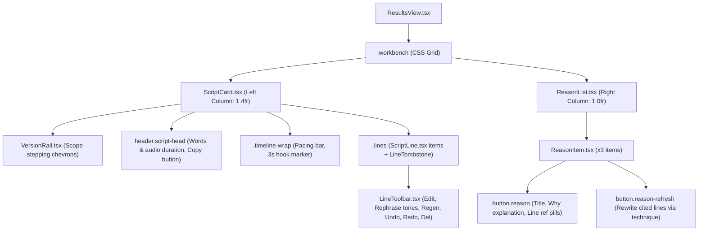

# Scene Editor UI Design & Architecture Context

> **Target Audience:** Design and Frontend Engineering Subagent  
> **Mission:** Design and draft the UI for **Phase 6: Visual Scenes & Storyboarding** within the UGC Script Writer workbench.  
> **Location in Pipeline:** Phase 6 of Sprint 4 (post-format setting, post-planning).

---

## 1. Executive Summary & Purpose

### 1.1 What are "Scenes"?
In `ug-script-writer`, an AI-generated script consists of spoken/voiced dialogue lines and psychological marketing rationales. While this produces great copy, video creators and production teams need **visual directions and storyboard prompts** to produce the video using AI video/image generators (Midjourney, Runway Gen-3, Kling, Sora, Pika, Flux) or real-world filming.

**Phase 6 (Scenes)** takes a finalized script and generates:
1. **Visual Style**: Palette, lighting, mood, camera feel.
2. **Character Roster**: Consistent character descriptions and wardrobe (ensuring characters don't morph between cuts).
3. **Beat-by-Beat Scenes**: Sequential visual clips tied to specific script lines, with place/setting, physical actions, props (featuring the grounded `product_appearance`), camera framing/movement, and on-screen text overlays.
4. **Deterministic Generation Prompts**: A self-contained, model-neutral English generation prompt constructed by pure code composition (not hallucinated by the LLM) ready for 1-click copy.

### 1.2 User Workflow
1. User generates scripts for customer segments (Stage 1 multimodal extraction $\to$ Stage 2 parallel script generation).
2. User selects an active segment and reviews the script in the `.workbench`.
3. User clicks **"Generate Visual Scenes"** on the active script.
4. The Scene Editor panel renders the visual style, character roster, and sequential scene cards.
5. User can:
   - Hover/select scenes to light up matching dialogue lines in `<ScriptCard />` (and vice-versa).
   - Copy individual visual directions or copy full AI generation prompts.
   - Edit character descriptions, wardrobe, or visual style (instantly recomposing generation prompts without LLM roundtrips).
   - In-place edit or regenerate single scenes.
   - Receive visual warnings when a script line is modified after scenes were generated (stale state).

---

## 2. Current Workbench Architecture (`.workbench`)

The workbench is rendered in [`ResultsView.tsx`](file:///home/bast0k/projects/ug-script-writer/apps/web/src/components/ResultsView.tsx) within the container:
```tsx
<div className={`workbench${isScriptUpdating ? ' is-updating' : ''}`}>
  <ScriptCard ... />
  <ReasonList ... />
  {/* Proposed: SceneEditor panel will integrate here or alongside */}
</div>
```

### 2.1 Existing Panels & Component Tree



### 2.2 Layout & Responsiveness
From [`apps/web/src/App.css`](file:///home/bast0k/projects/ug-script-writer/apps/web/src/App.css):
```css
.workbench {
  display: grid;
  gap: 20px;
  align-items: start;
  transition: opacity 0.3s ease;
}

@media (min-width: 980px) {
  .workbench {
    grid-template-columns: minmax(0, 1.4fr) minmax(0, 1fr);
  }
  .reasons {
    position: sticky;
    top: 20px;
  }
}

.workbench.is-updating {
  pointer-events: none;
  user-select: none;
  animation: workbenchPulse 1.2s ease-in-out infinite alternate;
}
```

### 2.3 Panel Details

#### Left Column: `<ScriptCard />` (`1.4fr`)
- **Header**: Word count, estimated spoken duration (`Math.round(totalWords * 0.4)` sec), script version label, "Copy script" button.
- **Audio Pacing Bar (`.timeline-wrap`)**: Visual progress segments proportioned by line durations (`duration = word_count * 0.4`), with a vertical indicator marking the critical **3-second Hook Window**.
- **Dialogue Lines (`<ScriptLine />`)**:
  - Sequential numbered lines (1, 2, 3...).
  - Line Kind badge: `Hook`, `Pain`, `Concept`, `Feature`, `Social Proof`, `CTA`.
  - Timestamp indicator (e.g. `0:00`, `0:03`).
  - Dialogue text (Bangla or English depending on user selection).
  - Speaker / Visual cue annotations (e.g. `Creator holding cheap sneaker`).
  - Interactive Action Toolbar on hover/focus (`LineToolbar.tsx`):
    - Inline edit (pencil).
    - Rephrase menu with tone chips (`punchier`, `casual`, `urgent`, `curious`, etc.).
    - Regenerate single line.
    - Delete line (creates a reversible `LineTombstone`).
    - Version history chevrons (`VersionRail.tsx`) pinned to the active line.

#### Right Column: `<ReasonList />` (`1.0fr`)
- **Sticky container** (`position: sticky; top: 20px`).
- Exactly **3 Psychological Reasoning Items** explaining why the script converts:
  - Technique title (e.g. `Pain-Point Contrast Hook`, `Demonstration of Value`).
  - "Why" rationale narrative.
  - Line citation pills (`Line 1`, `Line 2`).
  - Technique-level refresh icon button to trigger `POST /script/rewrite-lines-for-reason`.

### 2.4 Bi-directional Highlighting & State Coordination
Selection and hover states are tightly synchronized across panels via [`apps/web/src/state/workspace.ts`](file:///home/bast0k/projects/ug-script-writer/apps/web/src/state/workspace.ts) and [`ResultsView.tsx`](file:///home/bast0k/projects/ug-script-writer/apps/web/src/components/ResultsView.tsx):
- `workspace.selection`:
  ```ts
  export type Selection =
    | { kind: 'none' }
    | { kind: 'reason'; reasonUid: Uid }
    | { kind: 'line'; uid: Uid };
  ```
- **Hovering / Selecting a Reason**:
  - Extracts cited lines via `resolveVisibleCover(activeDoc, reason.cites)`.
  - Calculates `litLineUids` set.
  - Script lines in `litLineUids` receive `.line.is-lit` and full opacity; other lines dim (`.line.is-dim`).
- **Hovering / Selecting a Script Line**:
  - Finds all reasons whose citations cover this line.
  - Calculates `litReasonIndexes` set.
  - Associated reasons receive `.reason.is-lit`.
- **Clicking Outside**: Resets selection to `{ kind: 'none' }`.

---

## 3. Proposed Data Model for Scenes

As specified in Sprint 4 Architecture & `ideas.plans.md` (Section 11), scenes decouple global visual styling and character identity from the sequential shots to ensure **visual continuity across cuts**.

### 3.1 Backend Data Model (Pydantic / Python)

```python
from pydantic import BaseModel, Field

class Character(BaseModel):
    """A recurring cast member or persona in the video."""
    id: str = Field(description="Stable handle, e.g. 'c1', 'c2'")
    label: str = Field(description="Short human handle, e.g. 'The Commuter', 'Fitness Coach'")
    description: str = Field(description="Age range, build, hair, distinguishing facial features")
    wardrobe: str = Field(description="Default clothing and how the product looks on them")

class VisualStyle(BaseModel):
    """Global aesthetic bible applied across all scenes."""
    palette: str = Field(description="Dominant colors, e.g. 'cool blues, industrial slate, vivid orange accents'")
    lighting: str = Field(description="Lighting character, e.g. 'natural morning sunlight streaming through bus window'")
    mood: str = Field(description="Emotional aesthetic, e.g. 'relatable, energetic, authentic'")
    camera_feel: str = Field(description="Camera motion and texture, e.g. 'handheld smartphone POV, sharp 4K'")

class SceneCharacter(BaseModel):
    """Presence of a character in a specific scene."""
    character_id: str
    appearance_note: str | None = Field(
        default=None,
        description="Scene-specific deviation from default wardrobe, e.g. 'visibly sweating, jacket unzipped'"
    )

class Scene(BaseModel):
    """A visual shot or beat corresponding to one or more dialogue lines."""
    scene_number: int = Field(ge=1, description="Sequential 1-based scene index")
    line_ids: list[int] = Field(description="1-based script line IDs covered by this scene")
    duration_seconds: float = Field(gt=0, description="Estimated duration of this video cut")
    setting: str = Field(description="Location, environment, time of day (local to market)")
    characters: list[SceneCharacter] = Field(default_factory=list, description="Who is on-screen (empty for b-roll)")
    action: str = Field(description="Physical beat and movement seen by camera")
    props: str = Field(description="Key objects in frame, including product placement")
    camera: str = Field(description="Framing, angle, and camera motion (e.g. 'Close-up, rack focus')")
    on_screen_text: str | None = Field(default=None, description="Graphic text overlay in script language")
    generation_prompt: str = Field(default="", description="Deterministic English prompt composed by code")

class ScenesDraft(BaseModel):
    """LLM generation payload."""
    visual_style: VisualStyle
    characters: list[Character]
    scenes: list[Scene]

class ScriptScenes(ScenesDraft):
    """Stored and persisted scenes object."""
    product_appearance: str  # Grounded visual description extracted in Stage 1
    stale: bool = False      # Set true if underlying script lines are modified
```

### 3.2 Frontend TypeScript Interfaces (`packages/api-types` & `apps/web`)

```typescript
export interface Character {
  id: string; // "c1", "c2"
  label: string; // "The Commuter"
  description: string;
  wardrobe: string;
}

export interface VisualStyle {
  palette: string;
  lighting: string;
  mood: string;
  camera_feel: string;
}

export interface SceneCharacter {
  character_id: string;
  appearance_note?: string | null;
}

export interface Scene {
  scene_number: number;
  line_ids: number[]; // Script line numbers (1-indexed)
  duration_seconds: number;
  setting: string;
  characters: SceneCharacter[];
  action: string;
  props: string;
  camera: string;
  on_screen_text?: string | null;
  generation_prompt: string;
  pending?: boolean; // UI loading state during regeneration
}

export interface ScriptScenes {
  product_appearance: string;
  visual_style: VisualStyle;
  characters: Character[];
  scenes: Scene[];
  stale?: boolean;
}
```

### 3.3 The Deterministic Prompt Composer
The `generation_prompt` is **never written directly by the LLM**. Instead, a pure composition function compiles the prompt to ensure consistency and eliminate relative hallucinations ("same person as scene 1"):

```typescript
export function composeGenerationPrompt(
  scene: Scene,
  characters: Character[],
  style: VisualStyle,
  productAppearance: string
): string {
  const parts: string[] = [];

  // 1. Camera & Framing
  parts.push(`Cinematic ${scene.camera}.`);

  // 2. Setting & Environment
  parts.push(`Setting: ${scene.setting}.`);

  // 3. Characters & Wardrobe
  if (scene.characters.length === 0) {
    parts.push("No people on screen; product-focused macro shot.");
  } else {
    const castDescriptions = scene.characters.map((sc) => {
      const char = characters.find((c) => c.id === sc.character_id);
      if (!char) return "";
      const note = sc.appearance_note ? ` (Note: ${sc.appearance_note})` : "";
      return `${char.label}: ${char.description}, wearing ${char.wardrobe}${note}`;
    }).filter(Boolean);
    parts.push(`Characters: ${castDescriptions.join("; ")}.`);
  }

  // 4. Physical Action
  parts.push(`Action: ${scene.action}.`);

  // 5. Props & Product Appearance
  parts.push(`Props & Subject: ${scene.props}. Product details: ${productAppearance}.`);

  // 6. Aesthetic & Visual Style
  parts.push(`Visual Style: ${style.lighting}, ${style.palette} color palette, ${style.camera_feel}, ${style.mood} mood.`);

  return parts.join(" ");
}
```
> **Key UI Benefit:** When a user modifies a character's wardrobe or changes the visual lighting in the UI, the client can immediately recompose `generation_prompt` for all scenes **in zero milliseconds** without sending an LLM request!

---

## 4. Scene Editor Functional & UX Requirements

### 4.1 Core User Tasks
1. **Trigger Generation**:
   - A distinct "Generate Visual Storyboard" / "Create Scenes" button on the active script.
   - Shows progressive skeleton loading state while generating.
2. **Review Global Style & Characters**:
   - A collapsible header or drawer showing:
     - **Visual Style**: Palette swatches, lighting, camera movement, mood.
     - **Character Roster**: Chip list or avatars for each character (`c1`, `c2`) with their label, description, and wardrobe.
     - Editable inline or via an inspection popover/modal.
3. **Review & Navigate Sequential Scenes**:
   - Sequential cards: Scene 1, Scene 2, Scene 3...
   - Header badge displaying clip duration (e.g. `⏱ 4.5s`) and covered lines (e.g. `Lines 1-2`).
   - Clear visual typography separating:
     - **Setting** (Where are we?)
     - **Camera** (Framing & motion)
     - **Action** (What is happening?)
     - **Props / Product** (How does the product appear?)
     - **On-Screen Text Overlay** (Badge/banner in script language)
     - **AI Generation Prompt** (Monospace block with 1-click copy)
4. **Interactive Highlighting (Cross-Panel Sync)**:
   - Hovering or clicking a Scene card lights up the corresponding dialogue lines in `<ScriptCard />` (`litLineUids`).
   - Hovering or clicking a Script line in `<ScriptCard />` lights up the Scene(s) covering that line.
5. **Granular Editing & Regeneration**:
   - Editable text fields for setting, action, camera, and props.
   - "Regenerate Scene" button on each card (triggers single-scene regeneration preserving the rest).
6. **Stale State Management**:
   - If the user rephrases, edits, or deletes a script line after scenes exist, a subtle warning bar appears:
     > *"Script was modified. Scenes may be out of sync. [Regenerate Scenes]"*

---

## 5. UI Layout Options for Workbench Integration

The UI drafting agent should evaluate and propose layouts that fit naturally into the existing workbench layout.

```
Existing Layout (2 columns):
+------------------------------------+--------------------------+
|  ScriptCard (1.4fr)               |  ReasonList (1.0fr)      |
|  - Pacing timeline                |  - Sticky container      |
|  - Script lines & toolbar         |  - 3 marketing reasons   |
+------------------------------------+--------------------------+
```

### Option A: 3-Column Wide Workbench
- On wide displays (`min-width: 1400px`): `grid-template-columns: minmax(0, 1.3fr) minmax(0, 0.9fr) minmax(0, 1.4fr);`
- **Left**: `ScriptCard`
- **Middle**: `ReasonList` (compacted)
- **Right**: `SceneEditor`
- *Pros*: All three contexts visible simultaneously; perfect for large monitors.
- *Cons*: Can become cramped on 1080p laptop screens; requires responsive collapse.

### Option B: Workbench Tab Switcher in Right Column (Recommended)
- Right column hosts a unified segmented control:
  ```
  [ Why This Works (3) ]   [ Visual Scenes (4) ]
  ```
- Selecting **"Why This Works"** displays `<ReasonList />`.
- Selecting **"Visual Scenes"** displays `<SceneEditor />`.
- *Pros*: Preserves generous reading width on both panels; zero layout shift; highly intuitive on laptops and standard monitors; allows dedicated focus on visual storyboard.

### Option C: Bottom Storyboard Strip / Filmstrip Drawer
- Scenes rendered below `ScriptCard` and `ReasonList` as a horizontal filmstrip timeline.
- Clicking a thumbnail card opens a slide-over details drawer.
- *Pros*: Mimics traditional NLE video editing timelines.
- *Cons*: Requires heavy vertical scroll; disconnected from side-by-side line reading.

---

## 6. Project Directory & Implementation Mapping

When implementing Phase 6, the code will fit into the following repository structure:

```
ug-script-writer/
├── apps/
│   ├── api/
│   │   ├── schemas.py              # Pydantic schemas: Character, VisualStyle, Scene, ScriptScenes
│   │   ├── scenes.py               # Scene prompt assembly, compose_generation_prompt, validators
│   │   ├── main.py                 # Endpoints: POST /scenes/generate, POST /scenes/regenerate, POST /scenes/compose
│   │   └── tests/
│   │       └── test_scenes.py      # Unit tests for prompt composer, validators, mock endpoint tests
│   │
│   └── web/
│       └── src/
│           ├── components/
│           │   ├── ResultsView.tsx         # Orchestrates active tab/panel and cross-panel highlight state
│           │   ├── ScriptCard.tsx          # Script lines and timeline pacing
│           │   ├── ReasonList.tsx          # Marketing rationales panel
│           │   └── scenes/                 # [NEW] Scene editor component suite
│           │       ├── SceneEditor.tsx     # Main container with Cast/Style summary & scenes list
│           │       ├── SceneCard.tsx       # Individual scene card with camera, action, prompt copy
│           │       ├── CharacterRoster.tsx # Cast members chips / edit drawer
│           │       ├── VisualStyleBar.tsx  # Palette swatches, lighting, mood summary
│           │       └── SceneSkeleton.tsx   # Loading placeholder while scenes are generating
│           │
│           ├── state/
│           │   ├── types.ts                # TypeScript interfaces: Character, Scene, ScriptScenes
│           │   ├── workspace.ts            # Reducer actions: GENERATE_SCENES_*, UPDATE_SCENE, SET_SCENES_STALE
│           │   └── scene-composer.ts       # Client-side composeGenerationPrompt pure function
│           │
│           └── App.css                     # Styles for .scene-card, .character-roster, .prompt-box
│
└── packages/
    └── api-types/                          # Auto-generated shared types from FastAPI schema
        └── src/
            ├── schema.d.ts
            └── index.ts                    # Exports Scene, Character, VisualStyle, ScriptScenes
```

---

## 7. Design Tokens & Styling Language

The Scene Editor UI must strictly adhere to the app's established design language:
- **Design Tokens**:
  - Background surface: `var(--surface)` (white `#ffffff`)
  - Border edge: `var(--edge)` (`#e5e7eb`)
  - Deep typography: `var(--ink)` (`#111827`)
  - Muted labels: `var(--ink-2)` (`#4b5563`) and `var(--ink-3)` (`#9ca3af`)
  - Brand tint: `var(--tint)` (`#f9fafb`)
  - Primary accent: `var(--accent)` (`#e11d48` rose-600 / `#0f172a` slate-900)
- **Component Styling**:
  - Panels wrap inside `className="panel"`.
  - Iconography: `@tabler/icons-react` (stroke 1.5 - 2, 16px to 20px).
  - Badges/Pills: Rounded pills (`border-radius: 9999px`), `font-size: 0.75rem`, subtle background tint.
  - Cards: Border radius `12px` - `16px`, subtle box shadow `var(--shadow-sm)`.
  - Copy prompt box: Monospace (`font-family: var(--font-mono, monospace)`), clean dark or tinted card with copy button in top-right.

---

## 8. Checklist for the UI Drafting Agent

When drafting the Scene Editor component and mockup:
- [ ] Choose layout integration (Workbench tab switcher vs. 3-column grid).
- [ ] Design the Empty/Uncreated state with a prominent **"Generate Visual Storyboard"** call to action.
- [ ] Design the Loading/Generating skeleton state.
- [ ] Design the Character & Visual Style inspector (collapsible header or modal).
- [ ] Design the sequential `SceneCard`:
  - Scene number and timecode duration.
  - Linked script line badges.
  - Setting & camera badges.
  - Cast members present (with character tags).
  - Physical action beat.
  - Product framing & props.
  - Text overlay callout.
  - AI generation prompt container with 1-click copy and feedback toast.
  - Action buttons: Edit beat, Regenerate scene.
- [ ] Define the cross-panel highlighting interaction (hovering Scene highlights lines in `ScriptCard`).
- [ ] Design the Stale warning banner when script lines are edited.
